# LOCAL AI — Product Blueprint, Prototype and Android App

**Status (2026-11-17):** Blueprint **approved**. Implementation has started with **Milestone 1** (on-device inference, model manager, chat) plus **Lite mode for 4 GB and 6 GB phones** — see [`android/`](android/README.md).

**Try it on your phone:** every push that changes `local-ai/android/` builds a test APK with GitHub Actions and publishes it as the **`local-ai-latest`** pre-release on the repository's Releases page. Open that page on the phone, download `LocalAI-0.1.N.apk` and install it (Android 8.0+, 64-bit ARM).

The rest of this page is the approved planning package.

LOCAL AI is a private, offline-first Android app that runs open-weight LLMs on the phone and turns them into a personal AI environment: chat, specialised agents, supervised multi-agent workflows, local knowledge bases with retrieval (RAG), typed tools and user-controlled memory.

---

## 1. Product overview

| Module | What the user gets | MVP scope |
|---|---|---|
| Model Manager | Curated GGUF catalog, resumable verified downloads, GGUF import, per-model settings, memory estimate and a device-specific verdict | Full |
| AI Chat | Streaming, stop/regenerate, markdown + code, system prompts, KB selection with citations, attachments, agent mode, context meter | Full |
| Agent Studio | Agents as configurations (prompt, model, tools, KBs, memory, limits); 6 templates | Full |
| Multi-agent workflows | Supervisor → planner → agents → reviewer → aggregator, live DAG view, budgets, retry, cancel | Full (planner-driven); fixed user workflows in V1.x |
| Knowledge Studio | Multiple KBs (shared or agent-only), PDF/DOCX/TXT/MD/code/notes, hybrid semantic search, sources | Full; OCR in V1.x |
| Tool Registry | 8 typed tools with JSON-schema validation, permissions, audit log; no code execution | Full |
| Memory | Conversation, agent (approval inbox) and shared knowledge memory, kept separate | Full |
| Platform | Device detection, compatibility, performance monitor, privacy controls, no account, no analytics | Full |

Details: [`docs/PRODUCT_REQUIREMENTS.md`](docs/PRODUCT_REQUIREMENTS.md) (MVP vs V1.x vs experimental vs unsupported for every feature).

## 2. Recommended technology stack

| Layer | Choice | Why (short) |
|---|---|---|
| App | Kotlin 2.x, Jetpack Compose, Material 3, MVVM + unidirectional state, Hilt, Coroutines/Flow | First-party, streaming-friendly UI; structured concurrency gives cancellation for free |
| LLM runtime | **llama.cpp** (MIT) behind our own thin C API + JNI, pinned release | Native GGUF, broadest model support, best ARM CPU kernels, grammar-constrained JSON, mmap + quantised KV cache |
| Secondary runtime (later) | LiteRT-LM or ExecuTorch for NPU on selected models | Only they reach Qualcomm/MediaTek NPUs today; both need per-model conversion |
| Embeddings | Small GGUF embedding model through llama.cpp (proposed: multilingual-e5-small, 384-dim) | One native runtime; ONNX Runtime is the fallback |
| Vector + keyword search | Custom SQLite build with **sqlite-vec** + FTS5 (`knowledge.db`), hybrid RRF ranking | Transactional with chunk text, tiny footprint; brute-force KNN is fast enough for personal corpora |
| App data | Room on the AndroidX bundled SQLite driver (`app.db`), DataStore for settings | Standard, migration-tested |
| Background | WorkManager (downloads, indexing), foreground service for user-started long runs | Android background rules |
| Parsing | Own DOCX parser, platform PDF text API or PdfBox-Android, isolated process | Small, sandboxed |

Full comparison of llama.cpp, ExecuTorch, MLC LLM, ONNX Runtime GenAI and LiteRT-LM (integration, GGUF, CPU, GPU, NPU, memory, quantisation, models, maintenance, licence): [`docs/TECH_STACK_DECISION.md`](docs/TECH_STACK_DECISION.md).

## 3. Architecture diagrams

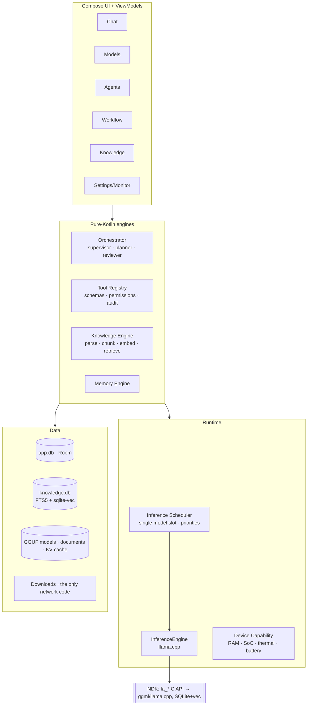

Supervisor workflow with the hybrid scheduler (LLM steps share one loaded model; tool calls overlap):

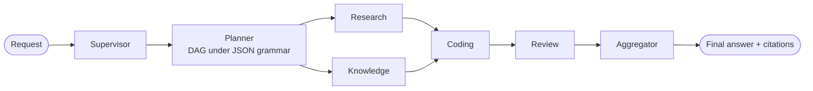

More diagrams (layered view, module graph, sequence diagrams for chat+RAG and downloads, ingestion pipeline, state machines, ER model): [`docs/SYSTEM_ARCHITECTURE.md`](docs/SYSTEM_ARCHITECTURE.md), [`docs/AGENT_ARCHITECTURE.md`](docs/AGENT_ARCHITECTURE.md), [`docs/KNOWLEDGE_ENGINE_DESIGN.md`](docs/KNOWLEDGE_ENGINE_DESIGN.md), [`docs/DATABASE_SCHEMA.md`](docs/DATABASE_SCHEMA.md).

## 4. Major engineering decisions

| # | Decision | Key trade-off | ADR |
|---|---|---|---|
| 1 | Native Kotlin/Compose, Android-only first | Best platform access vs. no iOS; engines stay portable to KMP | [0001](docs/ADR/0001-native-kotlin-compose.md) |
| 2 | llama.cpp primary runtime | GGUF breadth + CPU everywhere vs. no NPU and upstream churn | [0002](docs/ADR/0002-llama-cpp-primary-runtime.md) |
| 3 | Logical agents share one loaded model | Predictable RAM vs. serialised LLM steps (mitigated by KV prefix caching) | [0003](docs/ADR/0003-single-shared-model-for-agents.md) |
| 4 | sqlite-vec + FTS5 in our own SQLite build | Small, transactional vs. pre-1.0 dependency we must maintain | [0004](docs/ADR/0004-sqlite-vec-knowledge-store.md) |
| 5 | Embeddings via llama.cpp | One runtime vs. needs verification of e5/XLM-R support | [0005](docs/ADR/0005-embeddings-via-llama-cpp.md) |
| 6 | Custom Kotlin orchestrator, grammar-constrained plans and tool calls | Reliability with 3–8B models vs. we own the prompt engineering | [0006](docs/ADR/0006-custom-kotlin-orchestrator.md) |
| 7 | Typed tools only, never execute generated code | Safety vs. flexibility | [0007](docs/ADR/0007-typed-tools-no-code-execution.md) |
| 8 | Single network boundary (downloads module) | Verifiable privacy vs. no remote crash insight | [0008](docs/ADR/0008-offline-first-network-boundary.md) |
| 9 | Memory separate from knowledge; approval by default | User trust vs. extra UI | [0009](docs/ADR/0009-memory-separate-from-knowledge.md) |
| 10 | Dependency-free web prototype, isolated | Fast iteration vs. throwaway code | [0010](docs/ADR/0010-isolated-web-prototype.md) |

Device strategy (from [`MODEL_RUNTIME_DESIGN.md`](docs/MODEL_RUNTIME_DESIGN.md)): model budget = `0.5 × RAM − 0.4 GB`; estimate = weights + KV cache (from GGUF metadata) + compute + runtime. 8 GB phones: 3B runs well, 4B is a tight fit at 4K context with q8_0 KV. 12 GB: 4B comfortably, 7–8B tight. 16 GB: 8B comfortably, 12B tight. CPU by default; Adreno OpenCL opt-in after a self-test. Thermal/battery/memory-pressure responses are specified step by step.

## 5. Project structure

```
local-ai/
├─ README.md                      ← this presentation
├─ docs/
│  ├─ PRODUCT_REQUIREMENTS.md     scope, personas, NFRs, journeys
│  ├─ SYSTEM_ARCHITECTURE.md      layers, modules, components, data flows, errors
│  ├─ TECH_STACK_DECISION.md      research + comparisons + sources
│  ├─ MODEL_RUNTIME_DESIGN.md     native layer, API, scheduler, memory estimate, device detection
│  ├─ AGENT_ARCHITECTURE.md       single-agent loop, supervisor DAG, budgets, recovery
│  ├─ KNOWLEDGE_ENGINE_DESIGN.md  ingestion, chunking, embeddings, hybrid retrieval, memory system
│  ├─ DATABASE_SCHEMA.md          ER diagram, DDL, repository contracts, migrations
│  ├─ SECURITY_AND_PRIVACY.md     threat model, tool sandbox, network boundary, permissions
│  ├─ PERFORMANCE_STRATEGY.md     budgets per RAM tier, latency, thermal, storage
│  ├─ IMPLEMENTATION_ROADMAP.md   spikes, milestones, estimates
│  ├─ TESTING_STRATEGY.md         pyramid, determinism, scenarios
│  ├─ UI_UX_SPECIFICATION.md      tokens, components, navigation, 17 screen specs, refinements
│  └─ ADR/                        10 architecture decision records
└─ prototype/                     interactive UI prototype (no build, no dependencies)
   ├─ index.html · css/ · js/ · tests/smoke.mjs · tools/bundle.mjs · screenshots/
```

Proposed Android project layout (for Phase 0+), from `SYSTEM_ARCHITECTURE.md §3`: `app`, `core/{common, designsystem, model, database, datastore, native}`, `runtime/{inference, device}`, `engine/{agents, knowledge, tools, memory}`, `data/downloads`, `feature/{onboarding, home, chat, models, agents, workflow, knowledge, tools, memory, settings, monitor}`.

## 6. UI prototype — launch instructions

```bash
# from the repository root
open local-ai/prototype/index.html                      # or xdg-open / start; no server needed
# or, to try it on a phone on the same network:
cd local-ai/prototype && python3 -m http.server 8080    # then http://<computer-ip>:8080
```

A hosted single-file build is also available (private link; share it from the page's Share menu): https://claude.ai/artifact/KUpytrzTnqW1V3fFdv18Ao

Desktop shows the app in a phone frame with a clickable index of all 17 screens; phones run it full-screen. See [`prototype/README.md`](prototype/README.md) for a guided list of things to try.

## 7. Prototype screenshots

Phone width (412 px), captured by the automated test run. All data is sample data.

| | | |
|---|---|---|
| 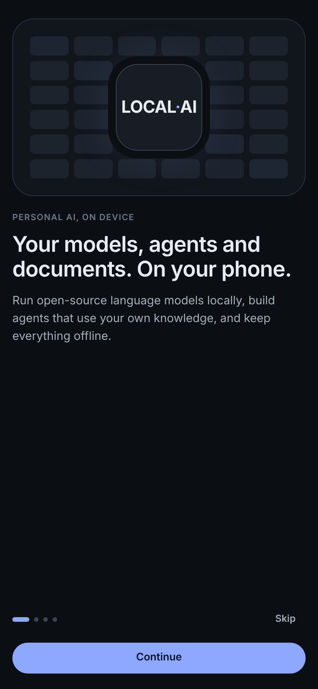 Welcome | 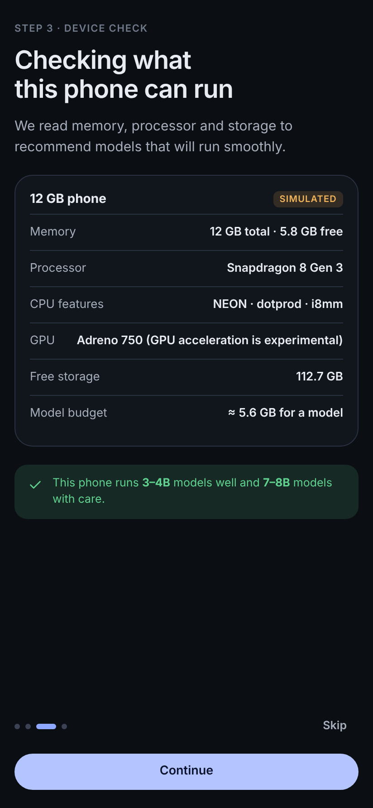 Device check | 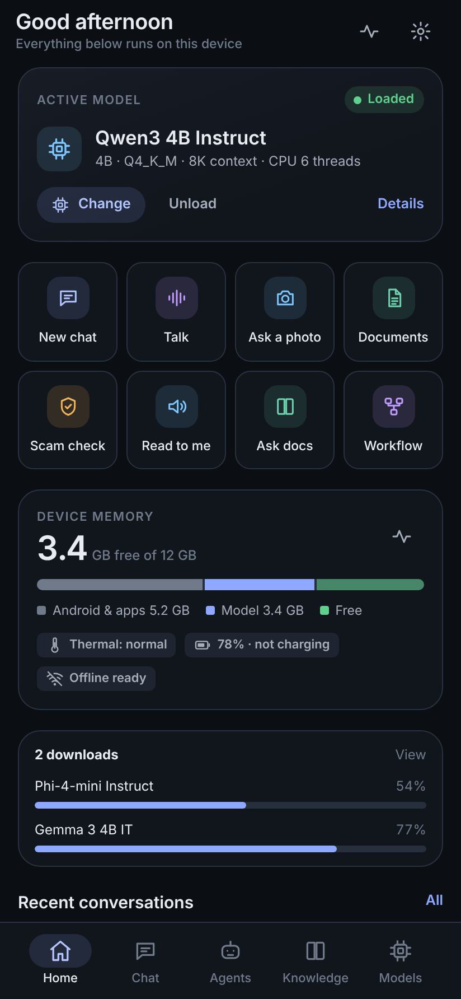 Home |
| 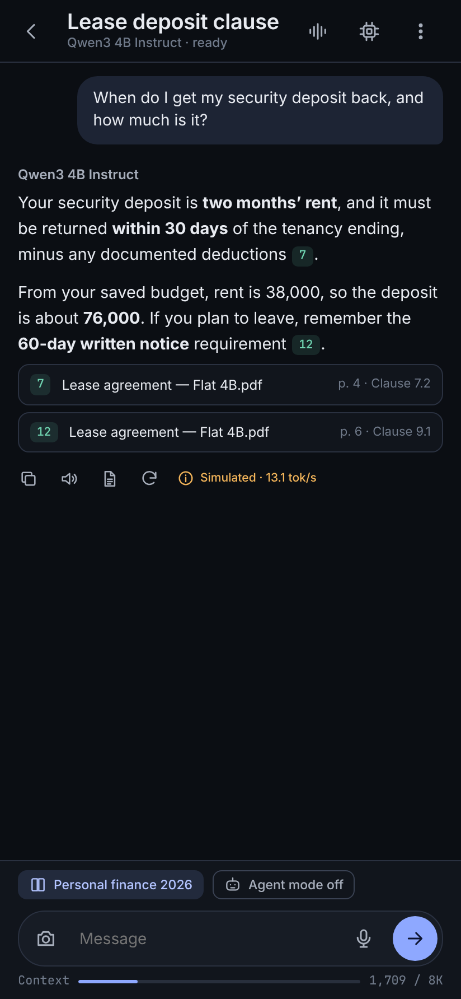 Chat with citations | 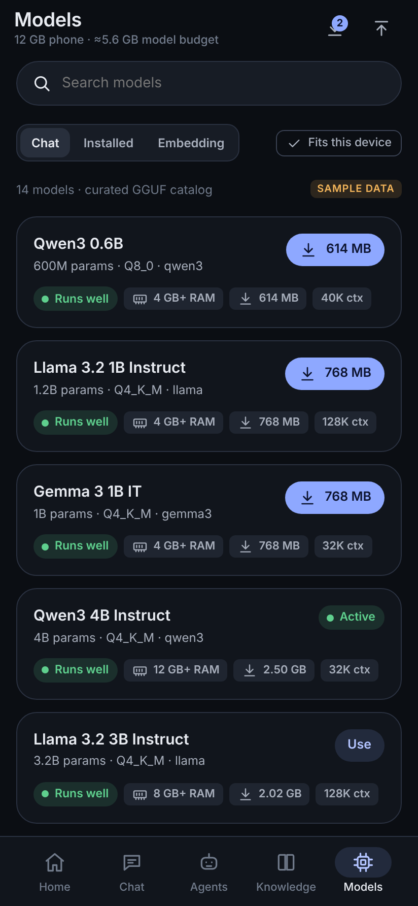 Model library | 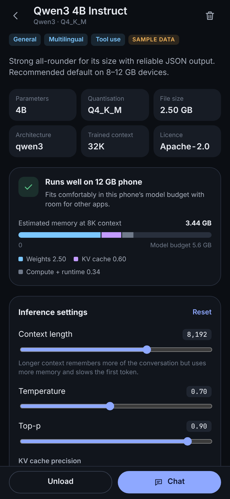 Model details |
| 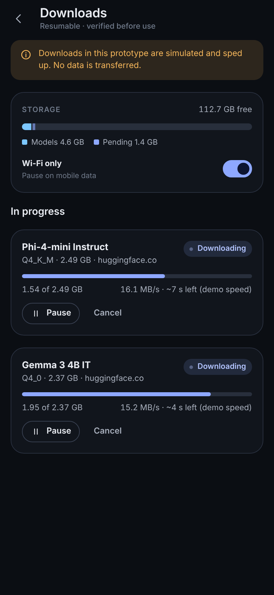 Downloads | 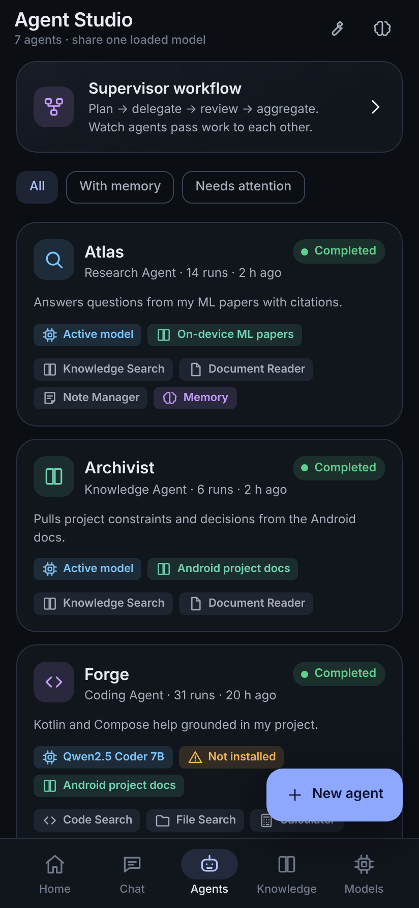 Agent Studio | 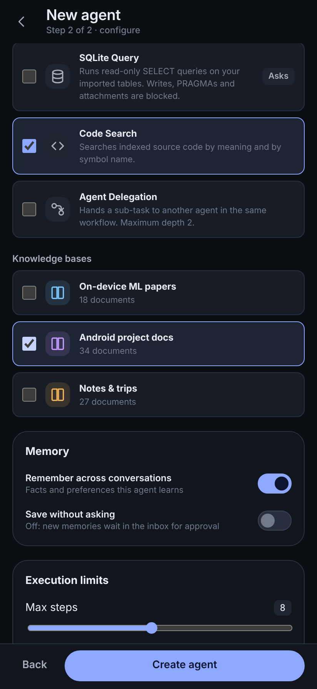 Create agent |
| 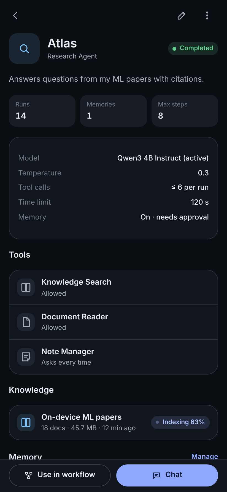 Agent details | 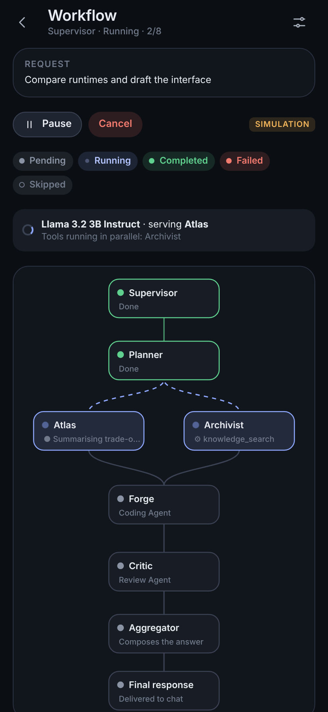 Workflow running | 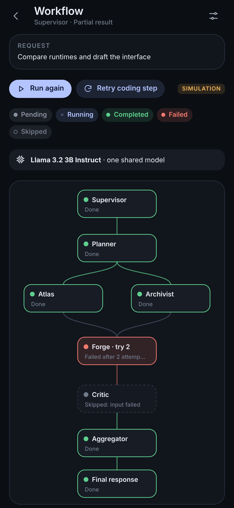 Failure + skipped steps |
| 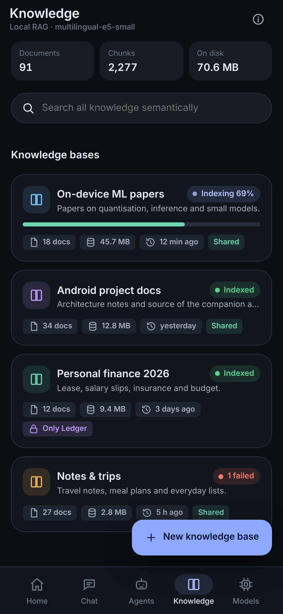 Knowledge | 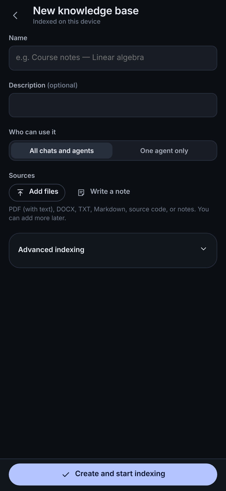 Create KB | 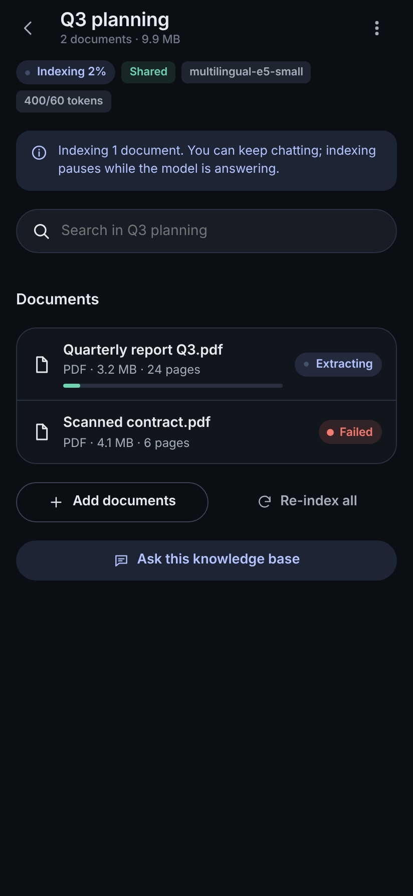 Indexing |
| 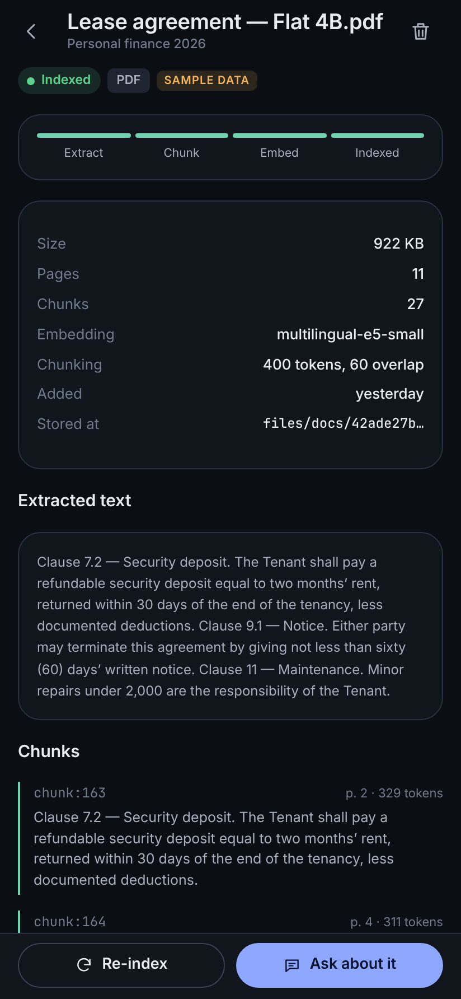 Document details | 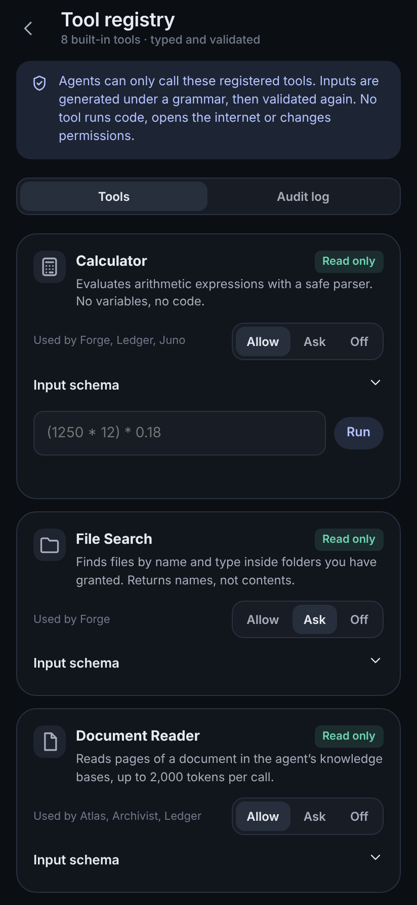 Tool registry | 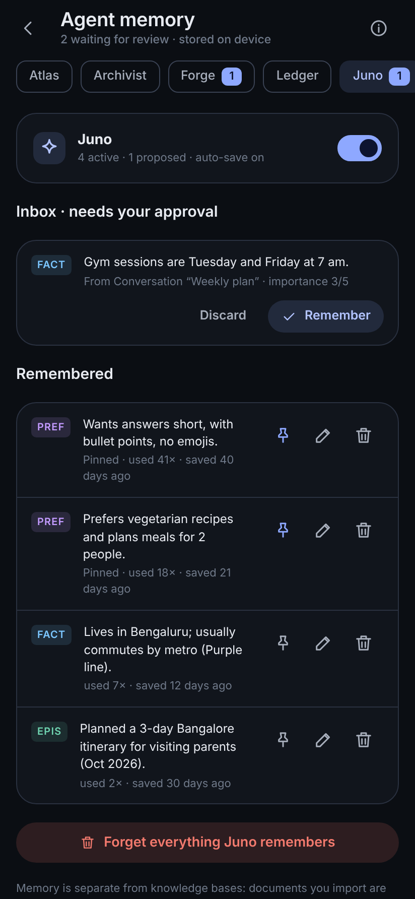 Agent memory |
| 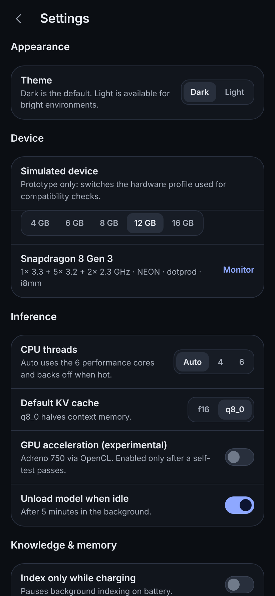 Settings | 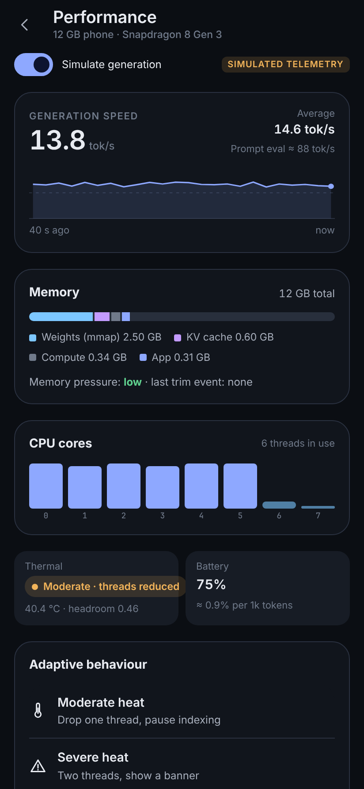 Performance | 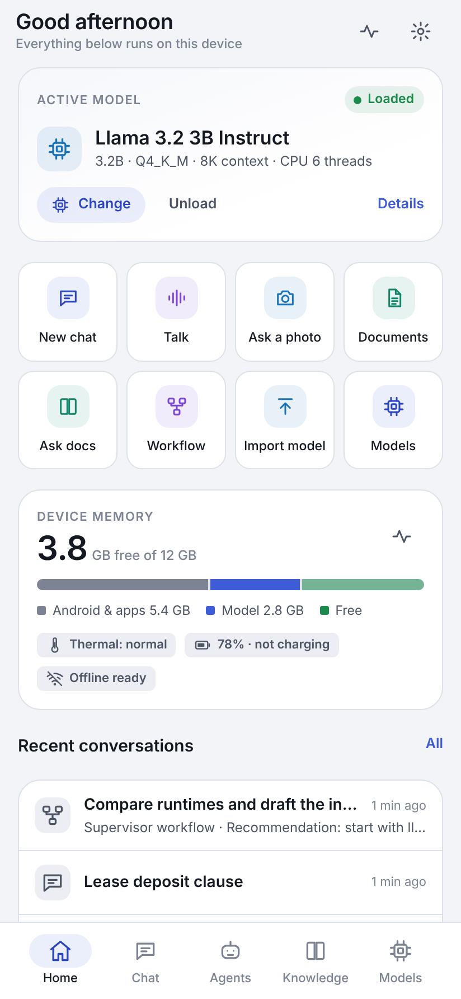 Light theme |

Desktop review layout: 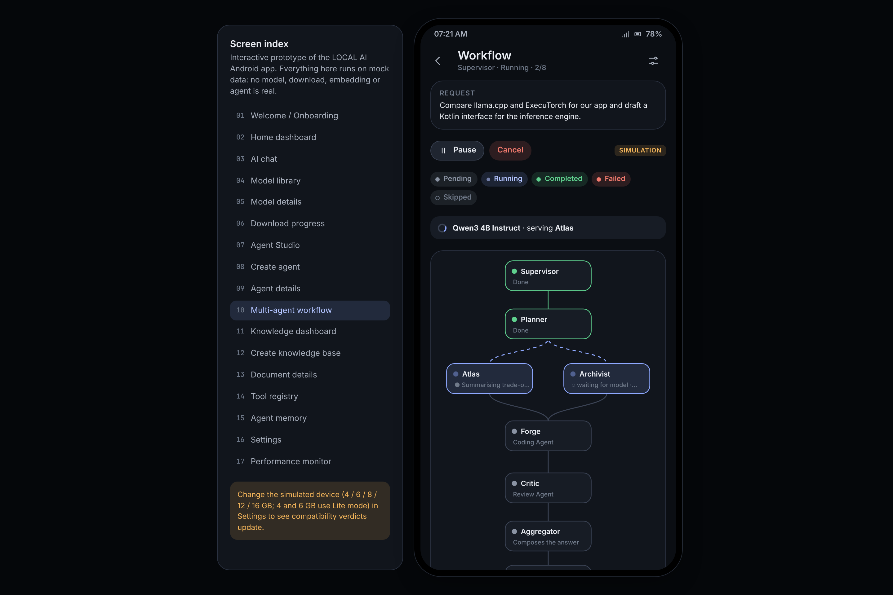

## 8. Tested interactions

`node local-ai/prototype/tests/smoke.mjs` (Playwright, Chromium, 412 × 892 viewport). Final run: **35 / 35 passed**.

- Onboarding: 4 steps, device check, starter model download.
- All 17 screens render with no horizontal overflow at phone width and no console errors.
- Model selection from Home (simulated load), context slider updating memory estimate and verdict, device switch (8 GB → Llama 3.1 8B "Not recommended"), download pause/resume.
- Chat: streaming with citations, source sheet, stop mid-stream, regenerate, KB picker, agent mode; agent-mode message runs the supervisor workflow and delivers the final answer into the chat.
- Agent creation with validation (missing name), template, KB assignment, appears in studio.
- KB creation with validation, file picker, indexing progress, scanned PDF failing with OCR message; semantic search results.
- Workflow: transient failure with retry, permanent failure with skipped review + partial answer + "retry step", cancel mid-run.
- Tool registry: safe calculator (rejects `alert(1)`), permission change.
- Memory: approve proposal, delete. Light theme.

Issues found and fixed during testing are logged in `docs/UI_UX_SPECIFICATION.md §8` (refresh destroying sheets and input state, slider re-rendering mid-drag, FAB overlapping the nav bar, duplicate downloads from onboarding, workflow-graph dot and label glitches, a 5 px overflow, and an over-conservative memory formula).

## 9. Known limitations

**Prototype**
- Everything is simulated: no inference, downloads, embeddings, parsing, persistence beyond browser local storage. Search ranking is keyword-based mock scoring.
- Web approximations of Android: no system back gesture, real file picker, notifications, haptics or Material You colour.
- Fonts load from Google Fonts; offline it falls back to system fonts.
- Tested in Chromium only; layout targets phone widths 360–430 px.

**Blueprint (needs Phase 0 verification)**
- Performance targets are estimates, not measurements. The memory-budget constants need calibration on real devices.
- multilingual-e5-small support in llama.cpp, the PDF text extraction route, and llama.cpp dynamic CPU-variant loading are marked **verify in spike**.
- sqlite-vec is pre-1.0; mitigated by an interface and a brute-force fallback.
- No NPU acceleration at MVP.
- Long workflows in the background depend on a foreground-service type decision (question 3 below).

## 10. Implementation roadmap

| Phase | Duration | Exit criterion |
|---|---|---|
| 0 · Technical spikes | 3 wks | 4B model ≥ 8 tok/s on 8 GB device; grammar JSON ≥ 99 % valid; sqlite-vec 50k KNN ≤ 80 ms; go/no-go with you |
| M1 · Foundation, Model Manager, Chat | 7 wks | Internal alpha on 5 reference devices |
| M2 · Knowledge Studio + RAG | 6 wks | recall@8 ≥ 0.85 on eval set |
| M3 · Agents + Tools + Memory | 6 wks | 40 scripted scenarios pass; ≥ 80 % task success on real 4B model |
| M4 · Multi-agent orchestration | 6 wks | 20 workflows within budgets on 8 GB; cancel ≤ 300 ms |
| M5 · Hardening + beta | 5 wks | Release candidate |

Details: [`docs/IMPLEMENTATION_ROADMAP.md`](docs/IMPLEMENTATION_ROADMAP.md).

## 11. Estimated engineering complexity

About **33 weeks to beta (~8 months)** for 2 Android engineers, 1 native/ML engineer, a part-time designer and QA from M2. Highest-risk areas: native runtime integration (device variance, crashes), knowledge engine (PDF variance, multilingual embeddings), and small-model reliability in multi-agent orchestration. Medium: downloads, chat rendering performance, tools, memory UX, thermal behaviour.

## 12. Questions requiring your approval

**Resolved on 2026-11-17:** the design was approved, and 4 GB / 6 GB support was added as Lite mode (question 2 is now minSdk **26**, arm64 only; see ADR-0011). The remaining questions still apply to later milestones.

1. **Runtime:** approve llama.cpp as the primary runtime, with LiteRT-LM/ExecuTorch evaluated later for NPU?
2. **minSdk 31 (Android 12), arm64 only?** Lowering to API 29 adds test cost for few capable devices.
3. **Background execution:** may long workflows continue in the background via a user-started foreground service (Play policy declaration needed), or should runs pause when the app leaves the screen?
4. **Model catalog:** curated catalog only at MVP (plus GGUF import), or free Hugging Face browsing from day one?
5. **Default embedding model:** multilingual (multilingual-e5-small, ~120 MB) or English-only (bge-small-en, ~67 MB)? Which languages matter most for your users?
6. **Memory default:** require approval for every new agent memory (proposed), or auto-save with an undo log?
7. **Encryption:** rely on Android file-based encryption at MVP, with an optional SQLCipher "vault" in V1.x, or make encryption mandatory from MVP (+5–15 % DB cost)?
8. **OCR:** acceptable to defer scanned-PDF support to V1.x?
9. **Team and timeline:** does the ~8-month plan with the team above match your constraints?
10. **Repository:** this package lives in `local-ai/` inside the current repository (a Go concurrency tutorial). Should the Android project start in a new, dedicated repository?
