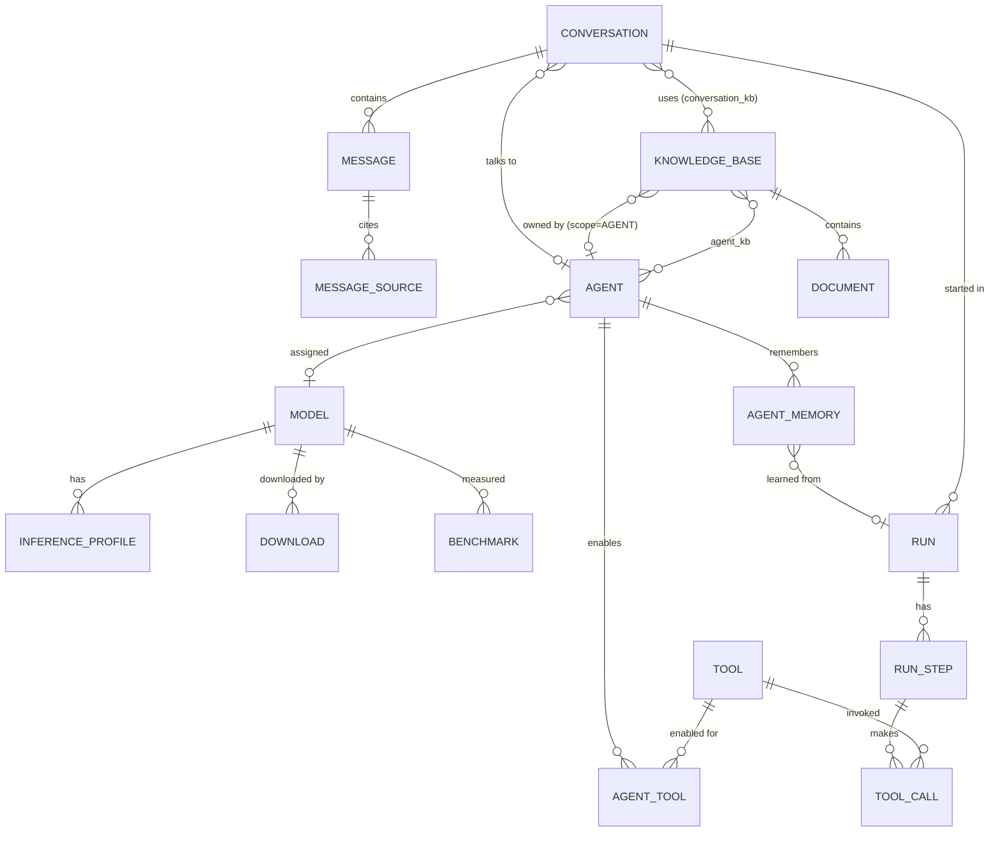

# Database Schema and Interface Contracts

Status: Draft for approval · Phase 4 output

## 1. Storage map

| Store | Technology | Contents | Rebuildable? |
|---|---|---|---|
| `app.db` | Room on AndroidX bundled SQLite, WAL | Models, profiles, downloads, conversations, messages, agents, tools, permissions, KB + document metadata, runs, memory items | No (backed up locally, 2 rolling snapshots) |
| `knowledge.db` | Custom SQLite build (FTS5 + sqlite-vec) | Chunks, FTS index, chunk vectors, memory vectors | Yes (from stored documents and memory text) |
| DataStore (proto) | `settings.pb` | Theme, defaults, privacy toggles, onboarding state | Defaults if lost |
| Files | `noBackupFilesDir/models`, `filesDir/docs`, `cache/kv` | GGUF, document copies, KV prefix caches | Models re-downloadable; docs not |

IDs: ULIDs as `TEXT` in `app.db` (sortable, generated offline); integer rowids in `knowledge.db` for vec0 compatibility.

## 2. Entity relationships (`app.db`)



## 3. Tables

### Models and downloads

```sql
CREATE TABLE model (
  id TEXT PRIMARY KEY,                -- catalog id e.g. "qwen3-4b-instruct-q4_k_m" or "import:<sha>"
  display_name TEXT NOT NULL,
  family TEXT NOT NULL,               -- qwen3, llama, gemma3, phi3 …
  architecture TEXT NOT NULL,         -- general.architecture from GGUF
  parameter_count INTEGER NOT NULL,
  quantization TEXT NOT NULL,         -- Q4_K_M, Q8_0 …
  file_size_bytes INTEGER NOT NULL,
  sha256 TEXT NOT NULL,
  n_layer INTEGER, n_head_kv INTEGER, head_dim INTEGER, n_ctx_train INTEGER,
  license TEXT NOT NULL,
  purpose TEXT NOT NULL CHECK (purpose IN ('GENERATION','EMBEDDING')),
  backend TEXT NOT NULL DEFAULT 'LLAMA_CPP',
  source TEXT NOT NULL CHECK (source IN ('CATALOG','IMPORT')),
  file_path TEXT,                     -- null until installed
  installed_at INTEGER,
  is_active INTEGER NOT NULL DEFAULT 0
);
CREATE UNIQUE INDEX one_active_generation ON model(is_active) WHERE is_active = 1 AND purpose = 'GENERATION';

CREATE TABLE inference_profile (
  id TEXT PRIMARY KEY, model_id TEXT NOT NULL REFERENCES model(id) ON DELETE CASCADE,
  name TEXT NOT NULL, context_length INTEGER NOT NULL, temperature REAL NOT NULL, top_p REAL NOT NULL,
  top_k INTEGER NOT NULL, min_p REAL NOT NULL, repeat_penalty REAL NOT NULL, max_tokens INTEGER NOT NULL,
  kv_cache_type TEXT NOT NULL, gpu_layers INTEGER NOT NULL DEFAULT 0, is_default INTEGER NOT NULL DEFAULT 0
);

CREATE TABLE download (
  id TEXT PRIMARY KEY, model_id TEXT NOT NULL REFERENCES model(id),
  url TEXT NOT NULL, bytes_total INTEGER, bytes_done INTEGER NOT NULL DEFAULT 0,
  state TEXT NOT NULL CHECK (state IN ('QUEUED','RUNNING','PAUSED','VERIFYING','DONE','FAILED','CANCELLED')),
  error TEXT, work_id TEXT, created_at INTEGER NOT NULL, updated_at INTEGER NOT NULL
);

CREATE TABLE benchmark (
  id TEXT PRIMARY KEY, model_id TEXT NOT NULL REFERENCES model(id) ON DELETE CASCADE,
  backend TEXT NOT NULL, threads INTEGER NOT NULL, prompt_tps REAL NOT NULL, gen_tps REAL NOT NULL,
  peak_pss_mb INTEGER, thermal_start TEXT, thermal_end TEXT, created_at INTEGER NOT NULL
);
```

### Conversations

```sql
CREATE TABLE conversation (
  id TEXT PRIMARY KEY, title TEXT NOT NULL, model_id TEXT REFERENCES model(id) ON DELETE SET NULL,
  agent_id TEXT REFERENCES agent(id) ON DELETE SET NULL, system_prompt TEXT,
  summary TEXT, summary_upto_message_id TEXT, agent_mode INTEGER NOT NULL DEFAULT 0,
  created_at INTEGER NOT NULL, updated_at INTEGER NOT NULL, archived INTEGER NOT NULL DEFAULT 0
);
CREATE TABLE message (
  id TEXT PRIMARY KEY, conversation_id TEXT NOT NULL REFERENCES conversation(id) ON DELETE CASCADE,
  role TEXT NOT NULL CHECK (role IN ('SYSTEM','USER','ASSISTANT','TOOL')),
  content TEXT NOT NULL, status TEXT NOT NULL CHECK (status IN ('STREAMING','COMPLETE','STOPPED','ERROR')),
  model_id TEXT, run_id TEXT REFERENCES run(id) ON DELETE SET NULL,
  prompt_tokens INTEGER, completion_tokens INTEGER, gen_tps REAL,
  parent_message_id TEXT, created_at INTEGER NOT NULL
);
CREATE INDEX message_conv_time ON message(conversation_id, created_at);
CREATE TABLE message_source (
  message_id TEXT NOT NULL REFERENCES message(id) ON DELETE CASCADE,
  chunk_id INTEGER NOT NULL, document_id TEXT NOT NULL, score REAL NOT NULL, rank INTEGER NOT NULL,
  PRIMARY KEY (message_id, chunk_id)
);
CREATE TABLE conversation_kb (
  conversation_id TEXT NOT NULL REFERENCES conversation(id) ON DELETE CASCADE,
  kb_id TEXT NOT NULL REFERENCES knowledge_base(id) ON DELETE CASCADE, PRIMARY KEY (conversation_id, kb_id)
);
CREATE TABLE attachment (
  id TEXT PRIMARY KEY, conversation_id TEXT NOT NULL REFERENCES conversation(id) ON DELETE CASCADE,
  document_id TEXT NOT NULL REFERENCES document(id) ON DELETE CASCADE   -- stored in hidden per-conversation KB
);
```

### Agents and tools

```sql
CREATE TABLE agent (
  id TEXT PRIMARY KEY, name TEXT NOT NULL, role TEXT NOT NULL, description TEXT NOT NULL,
  system_prompt TEXT NOT NULL, template_id TEXT, model_id TEXT REFERENCES model(id) ON DELETE SET NULL,
  is_system INTEGER NOT NULL DEFAULT 0, color TEXT NOT NULL, icon TEXT NOT NULL,
  memory_enabled INTEGER NOT NULL DEFAULT 1, memory_auto_save INTEGER NOT NULL DEFAULT 0, memory_max_items INTEGER NOT NULL DEFAULT 200,
  max_steps INTEGER NOT NULL DEFAULT 8, max_tool_calls INTEGER NOT NULL DEFAULT 6, timeout_sec INTEGER NOT NULL DEFAULT 120,
  temperature_override REAL, created_at INTEGER NOT NULL, updated_at INTEGER NOT NULL
);
CREATE TABLE tool (
  id TEXT PRIMARY KEY,                  -- 'calculator', 'knowledge_search', …
  version INTEGER NOT NULL, display_name TEXT NOT NULL, description TEXT NOT NULL,
  input_schema TEXT NOT NULL,           -- JSON Schema (draft 2020-12 subset)
  risk TEXT NOT NULL CHECK (risk IN ('READ','WRITE_LOCAL','DELEGATE')),
  global_permission TEXT NOT NULL CHECK (global_permission IN ('ALLOWED','ASK','OFF'))
);
CREATE TABLE agent_tool (
  agent_id TEXT NOT NULL REFERENCES agent(id) ON DELETE CASCADE, tool_id TEXT NOT NULL REFERENCES tool(id),
  permission_override TEXT CHECK (permission_override IN ('ALLOWED','ASK','OFF')), PRIMARY KEY (agent_id, tool_id)
);
CREATE TABLE agent_kb (
  agent_id TEXT NOT NULL REFERENCES agent(id) ON DELETE CASCADE,
  kb_id TEXT NOT NULL REFERENCES knowledge_base(id) ON DELETE CASCADE, PRIMARY KEY (agent_id, kb_id)
);
```

Effective permission = most restrictive of `tool.global_permission` and `agent_tool.permission_override`.

### Runs

```sql
CREATE TABLE run (
  id TEXT PRIMARY KEY, conversation_id TEXT REFERENCES conversation(id) ON DELETE SET NULL,
  kind TEXT NOT NULL CHECK (kind IN ('SINGLE_AGENT','SUPERVISOR')), root_agent_id TEXT,
  request TEXT NOT NULL, plan_json TEXT,
  status TEXT NOT NULL CHECK (status IN ('PLANNING','RUNNING','COMPLETED','FAILED','CANCELLED','INTERRUPTED')),
  tokens_used INTEGER NOT NULL DEFAULT 0, tool_calls_used INTEGER NOT NULL DEFAULT 0,
  started_at INTEGER NOT NULL, finished_at INTEGER, error TEXT
);
CREATE TABLE run_step (
  id TEXT PRIMARY KEY, run_id TEXT NOT NULL REFERENCES run(id) ON DELETE CASCADE,
  task_id TEXT NOT NULL, agent_id TEXT, instruction TEXT NOT NULL, depends_on TEXT NOT NULL,   -- JSON array
  state TEXT NOT NULL CHECK (state IN ('PENDING','RUNNING','COMPLETED','FAILED','SKIPPED','CANCELLED')),
  attempt INTEGER NOT NULL DEFAULT 1, output TEXT, error TEXT, tokens INTEGER,
  started_at INTEGER, finished_at INTEGER
);
CREATE TABLE tool_call (
  id TEXT PRIMARY KEY, step_id TEXT REFERENCES run_step(id) ON DELETE CASCADE, tool_id TEXT NOT NULL,
  args_json TEXT NOT NULL, result_json TEXT, status TEXT NOT NULL CHECK (status IN ('OK','INVALID','DENIED','TIMEOUT','ERROR')),
  confirmed_by_user INTEGER NOT NULL DEFAULT 0, duration_ms INTEGER, created_at INTEGER NOT NULL
);
```

### Knowledge (metadata) and memory

```sql
CREATE TABLE knowledge_base (
  id TEXT PRIMARY KEY, name TEXT NOT NULL, description TEXT, scope TEXT NOT NULL CHECK (scope IN ('SHARED','AGENT','CONVERSATION')),
  owner_agent_id TEXT REFERENCES agent(id) ON DELETE CASCADE, embedding_model_id TEXT NOT NULL, embedding_dim INTEGER NOT NULL,
  chunk_size INTEGER NOT NULL DEFAULT 400, chunk_overlap INTEGER NOT NULL DEFAULT 60, color TEXT NOT NULL,
  created_at INTEGER NOT NULL, updated_at INTEGER NOT NULL
);
CREATE TABLE document (
  id TEXT PRIMARY KEY, kb_id TEXT NOT NULL REFERENCES knowledge_base(id) ON DELETE CASCADE,
  title TEXT NOT NULL, mime TEXT NOT NULL, original_name TEXT NOT NULL, stored_path TEXT NOT NULL,
  sha256 TEXT NOT NULL, size_bytes INTEGER NOT NULL, page_count INTEGER,
  status TEXT NOT NULL CHECK (status IN ('QUEUED','EXTRACTING','CHUNKING','EMBEDDING','INDEXED','FAILED','NEEDS_REINDEX')),
  progress REAL NOT NULL DEFAULT 0, chunk_count INTEGER NOT NULL DEFAULT 0, error TEXT,
  created_at INTEGER NOT NULL, indexed_at INTEGER,
  UNIQUE (kb_id, sha256)
);
CREATE TABLE note (
  id TEXT PRIMARY KEY, kb_id TEXT REFERENCES knowledge_base(id) ON DELETE SET NULL, title TEXT NOT NULL,
  body TEXT NOT NULL, created_by TEXT NOT NULL CHECK (created_by IN ('USER','AGENT')), agent_id TEXT,
  created_at INTEGER NOT NULL, updated_at INTEGER NOT NULL
);
CREATE TABLE agent_memory (
  id TEXT PRIMARY KEY, agent_id TEXT NOT NULL REFERENCES agent(id) ON DELETE CASCADE,
  kind TEXT NOT NULL CHECK (kind IN ('FACT','PREFERENCE','EPISODE')), content TEXT NOT NULL CHECK (length(content) <= 280),
  importance INTEGER NOT NULL CHECK (importance BETWEEN 1 AND 5), pinned INTEGER NOT NULL DEFAULT 0,
  status TEXT NOT NULL CHECK (status IN ('PROPOSED','ACTIVE','ARCHIVED')),
  source_run_id TEXT REFERENCES run(id) ON DELETE SET NULL, replaces_memory_id TEXT,
  created_at INTEGER NOT NULL, last_used_at INTEGER, use_count INTEGER NOT NULL DEFAULT 0
);
CREATE INDEX memory_agent_status ON agent_memory(agent_id, status);
```

`knowledge.db` schema is in `KNOWLEDGE_ENGINE_DESIGN.md §5`.

Cross-database consistency: `app.db` is the source of truth. Deleting a document/memory deletes in `app.db` first, then enqueues a `knowledge.db` delete; a startup reconciler removes orphans in `knowledge.db`. Retrieval joins results back to `app.db` and silently drops orphans.

## 4. Repository and service contracts (Kotlin)

```kotlin
interface ModelRepository {
    fun observeCatalog(): Flow<List<CatalogModel>>
    fun observeInstalled(): Flow<List<InstalledModel>>
    suspend fun importGguf(uri: Uri): Result<InstalledModel, ImportError>
    suspend fun delete(id: ModelId)
    suspend fun setActive(id: ModelId)
    suspend fun saveProfile(profile: InferenceProfile)
}
interface DownloadRepository {
    fun observe(): Flow<List<DownloadState>>
    suspend fun enqueue(id: ModelId, wifiOnly: Boolean): Result<Unit, DownloadError>
    suspend fun pause(id: DownloadId); suspend fun resume(id: DownloadId); suspend fun cancel(id: DownloadId)
}
interface ConversationRepository {
    fun observeConversations(): Flow<List<ConversationSummary>>
    fun observeMessages(id: ConversationId): Flow<List<Message>>
    suspend fun create(options: ConversationOptions): ConversationId
    suspend fun delete(id: ConversationId)
}
interface AgentRepository {
    fun observeAgents(): Flow<List<Agent>>
    suspend fun upsert(agent: AgentDraft): Result<AgentId, ValidationError>
    suspend fun delete(id: AgentId)
    fun templates(): List<AgentTemplate>
}
interface KnowledgeRepository {
    fun observeKnowledgeBases(): Flow<List<KnowledgeBaseSummary>>
    suspend fun create(draft: KnowledgeBaseDraft): KbId
    fun ingest(kb: KbId, uris: List<Uri>): Flow<IngestProgress>
    suspend fun reindex(doc: DocId); suspend fun remove(doc: DocId)
    suspend fun search(query: String, scope: RetrievalScope, k: Int): List<RetrievedChunk>
}
interface MemoryRepository {
    fun observe(agent: AgentId, status: MemoryStatus? = null): Flow<List<MemoryItem>>
    suspend fun approve(id: MemoryId); suspend fun reject(id: MemoryId)
    suspend fun edit(id: MemoryId, content: String); suspend fun pin(id: MemoryId, pinned: Boolean)
    suspend fun delete(id: MemoryId); suspend fun forgetAll(agent: AgentId)
}
```

Validation errors are returned as values (`Result<T, E>`), not exceptions; exceptions are reserved for programming errors and native failures.

## 5. Migrations

- Room auto-migrations for additive changes; manual `Migration` with tests for anything else (`MigrationTestHelper` across every released schema version).
- `knowledge.db` has a `schema_version` pragma; on mismatch it is rebuilt from documents (with progress UI), never migrated in place.
