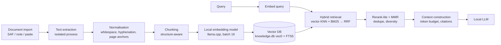

# Knowledge Engine and Memory Design

Status: Draft for approval · Phase 3 output

## 1. Pipeline



## 2. Import and extraction

| Type | Extensions | Extractor | Anchors kept |
|---|---|---|---|
| PDF | .pdf | Platform text API / PdfBox-Android | page number |
| Word | .docx | ZIP + XmlPullParser (paragraphs, headings by style, tables as TSV) | heading path |
| Text | .txt | Charset detect | line ranges |
| Markdown | .md | Headings parsed for structure | heading path |
| Code | .kt .java .py .js .ts .go .rs .c .cpp .h .swift .sql .json .yaml … | Plain text with language tag | file path + line ranges |
| Note | (in-app) | Direct | — |

Safety limits: max file 50 MB (PDF), 20 MB others; DOCX uncompressed total ≤ 100 MB and ratio ≤ 100×; extraction timeout 60 s per 100 pages; parser runs in an `isolatedProcess` service with no file system access except the passed fd.

Files are copied into `filesDir/docs/<sha256>` so indexes remain valid if the original moves. Duplicate (same hash) imports into the same KB are rejected with a message.

## 3. Chunking

- **Prose:** recursive splitter on headings → paragraphs → sentences; target 400 tokens, overlap 60 (configurable 200–800 / 0–150). Each chunk stores `heading_path` and `page_start/page_end`.
- **Code:** split on top-level declarations (regex-based per language at MVP; tree-sitter in V1.x), target 300 tokens, overlap 0; prepend file path and enclosing declaration signature.
- **Tables:** keep header row with each chunk of rows.
- Token counts use the **embedding model tokenizer**; generation-time budgeting uses the generation model tokenizer.
- A contextual header is prepended to the embedded text (not stored twice): `"{doc_title} › {heading_path}\n"`. This measurably improves retrieval for short chunks.

## 4. Embedding

- Default model: multilingual-e5-small (384-dim), pending spike verification; alternatives in `TECH_STACK_DECISION.md §4.2`.
- Prefixes as required by the model (e.g. `query:` / `passage:` for e5).
- L2-normalised float32 from the engine, stored as **int8** (scalar quantised, per-KB scale) in vec0; also an optional bit vector for coarse search when a KB exceeds 100k chunks.
- Batch 16 chunks; job yields to interactive work between batches; progress persisted per document so ingestion resumes after process death.
- KB records `embedding_model_id` + `dim`. Changing the model marks the KB "needs re-index".

## 5. Storage layout (`knowledge.db`)

```sql
CREATE TABLE chunk (
  id            INTEGER PRIMARY KEY,
  kb_id         TEXT NOT NULL,
  document_id   TEXT NOT NULL,
  ordinal       INTEGER NOT NULL,
  text          TEXT NOT NULL,
  heading_path  TEXT,
  page_start    INTEGER, page_end INTEGER,
  line_start    INTEGER, line_end INTEGER,
  token_count   INTEGER NOT NULL,
  content_hash  TEXT NOT NULL
);
CREATE INDEX chunk_doc ON chunk(document_id);

CREATE VIRTUAL TABLE chunk_fts USING fts5(text, heading_path, content='chunk', content_rowid='id', tokenize='unicode61 remove_diacritics 2');

CREATE VIRTUAL TABLE chunk_vec USING vec0(
  chunk_id INTEGER PRIMARY KEY,
  kb_id TEXT PARTITION KEY,          -- filter per KB without scanning others
  embedding int8[384]
);

CREATE TABLE memory_vec_map (memory_id TEXT PRIMARY KEY, rowid INTEGER UNIQUE);  -- agent memory embeddings live in a separate vec0 table
CREATE VIRTUAL TABLE memory_vec USING vec0(rowid INTEGER PRIMARY KEY, agent_id TEXT PARTITION KEY, embedding int8[384]);
```

Writes per batch happen in a single transaction (chunk + fts + vec), so a document is never half-indexed in a way retrieval can see: the document status in `app.db` flips to `INDEXED` only after the final batch commits. A startup reconciler deletes chunks whose `document_id` no longer exists in `app.db`.

## 6. Retrieval

1. Embed query (≈ 20–40 ms).
2. Vector KNN: `k=24` per selected KB partition.
3. Keyword: FTS5 BM25 `k=24` (handles names, codes, exact terms that embeddings miss).
4. Fuse with **Reciprocal Rank Fusion** (k=60).
5. MMR (λ=0.7) for diversity; drop near-duplicate chunks (same doc, overlapping ranges).
6. Return top `k=8` (configurable) with scores and source refs.

Optional V1.x: small cross-encoder reranker (e.g. bge-reranker-v2-m3 GGUF) for high-quality mode when budget allows.

```kotlin
interface Retriever {
    suspend fun retrieve(query: String, scope: RetrievalScope, k: Int = 8): List<RetrievedChunk>
}
data class RetrievalScope(val kbIds: Set<KbId>, val documentIds: Set<DocId>? = null)
data class RetrievedChunk(val chunkId: Long, val docId: DocId, val title: String, val text: String,
                          val score: Float, val page: IntRange?, val headingPath: String?)
```

## 7. Context construction

- Budget: `sources ≤ 40 %` of the step's input budget; remaining for system, memory, history, user turn.
- Greedy fill by fused score; truncate the last chunk at sentence boundary rather than dropping it if ≥ 60 % fits.
- Each chunk wrapped in `<source id="chunk:N" title="…" page="…">`. The answer prompt requires citing `[chunk:N]`; the UI maps those to tappable source chips. Unknown ids are stripped.
- Instruction-injection defence: sources are declared as untrusted data; tool calls with side effects always require confirmation regardless of what a source says.

## 8. Shared vs agent-specific knowledge bases

- `knowledge_bases.scope = SHARED | AGENT`. Agent-scoped KBs have `owner_agent_id` and appear only for that agent and in its details screen.
- Chat can select any shared KB; agent KBs are available in chat only when chatting with that agent.

## 9. Memory system (distinct from knowledge)

Knowledge = documents the user imports (read-only facts with provenance). Memory = what an agent learned from interactions. They are stored, displayed and deleted separately.

| Type | What | Storage | Write path | Read path | Delete |
|---|---|---|---|---|---|
| **Conversation memory** | Messages of one conversation + rolling summary | `messages`, `conversations.summary` | Every turn; summary updated when history exceeds 60 % of context | Last N turns + summary | With the conversation |
| **Agent memory** | Facts, preferences, episodic summaries per agent | `agent_memory` + `memory_vec` | (a) `remember` proposal by the agent during a run, (b) post-run extraction prompt proposing ≤ 3 items. Default **requires approval** ("Memory inbox"); user may switch an agent to auto-save | Recall top 5 by `0.6·similarity + 0.25·importance + 0.15·recency`, pinned always included, ≤ 400 tokens | Single item, all for agent, or all memory; deletes vector row in same operation; tombstone not kept |
| **Shared knowledge memory** | Knowledge bases | `documents`, `chunk*` | Ingestion | Retrieval | Remove document / KB |

Memory item fields: `kind (FACT | PREFERENCE | EPISODE)`, `content (≤ 280 chars)`, `importance 1–5`, `source_run_id`, `pinned`, `created_at`, `last_used_at`, `use_count`, `status (PROPOSED | ACTIVE | ARCHIVED)`.

Updates: if a new proposal has similarity ≥ 0.9 with an existing item, it is proposed as an **edit** of that item instead of a duplicate. Items unused for 180 days are suggested for archiving (never auto-deleted).

## 10. Quality evaluation

- A bundled evaluation set (50 Q/A over 10 public-domain documents) run in CI with the desktop build of the same native code: recall@8 ≥ 0.85, MRR ≥ 0.6.
- Chunking/embedding changes must not regress these metrics by > 3 %.
