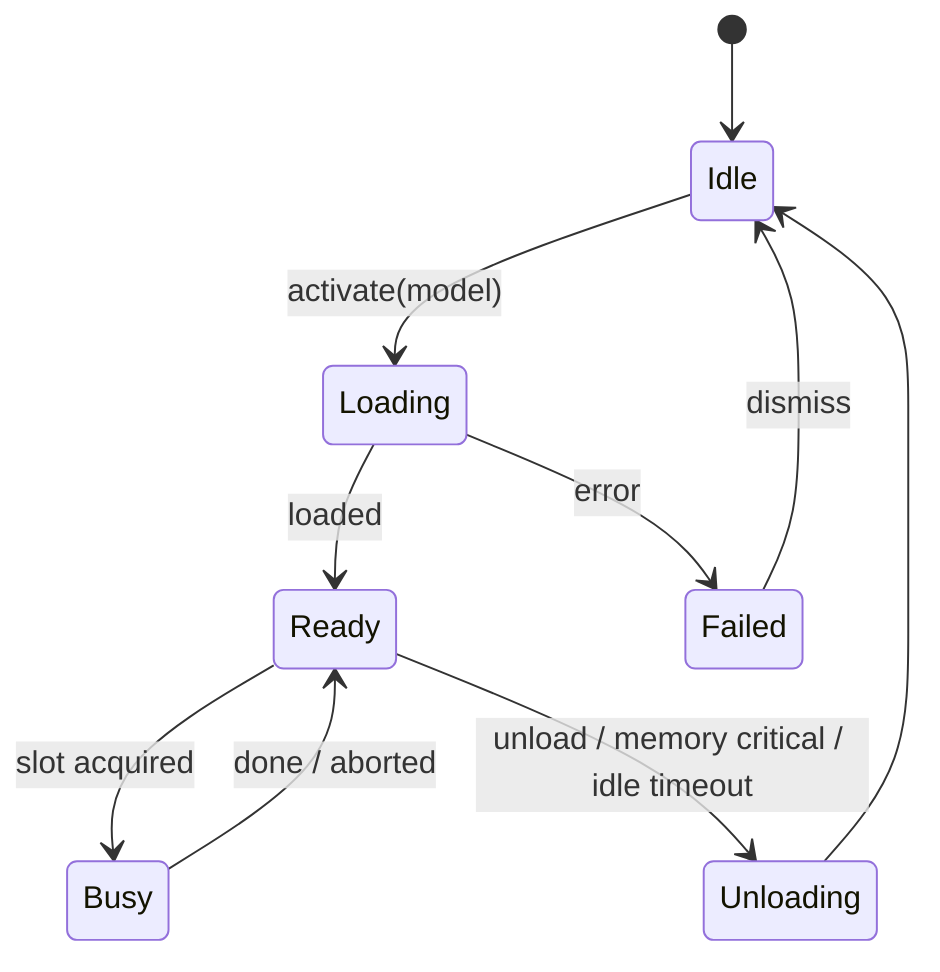

# Model Runtime Design

Status: Draft for approval · Phase 3 output

## 1. Goals

- Run GGUF models with llama.cpp on CPU everywhere, GPU where proven safe.
- Keep memory predictable and visible to the user before they load a model.
- One loaded generation model by default; a small embedding model may be co-resident.
- Cancellable, streaming, grammar-constrained generation.
- Backend-agnostic Kotlin API so other runtimes can be added later.

## 2. Native layer

```
core/native/
├─ CMakeLists.txt          # llama.cpp as subproject (pinned tag), sqlite amalgamation + sqlite-vec + FTS5
├─ third_party/llama.cpp   # git submodule, pinned
├─ third_party/sqlite-vec  # pinned
└─ src/
   ├─ la_engine.cpp        # our C API: la_model_load, la_ctx_new, la_decode, la_sample, la_embed, la_state_save/load, la_abort
   ├─ la_grammar.cpp       # JSON-schema → GBNF via llama.cpp's json-schema-to-grammar
   ├─ la_jni.cpp           # JNI glue only; no logic
   └─ la_knowledge.cpp     # SQLite open with vec0 + FTS5 registered
```

Principles:

- **Our own C API** (`la_*`) shields Kotlin from llama.cpp churn. Upgrading llama.cpp means fixing `la_engine.cpp` only.
- **No llama.cpp types cross JNI.** Handles are opaque `long`s; buffers are direct `ByteBuffer`s for embeddings.
- **Token streaming** is a JNI callback per batch of decoded pieces (UTF-8-safe boundary handling in C++ so partial multi-byte characters are never emitted).
- Build flags: `GGML_CPU_ARM_ARCH=armv8.2-a+dotprod+i8mm` variant plus a baseline `armv8-a` variant selected at runtime via CPU feature detection (two `.so` sets, or ggml's dynamic backend loading where stable — **verify in spike**). `GGML_OPENCL=ON` in a separate optional backend library.

## 3. Kotlin API

```kotlin
interface InferenceEngine {
    val backend: Backend                               // LLAMA_CPP, LITERT_LM (future), …
    suspend fun load(spec: ModelLoadSpec): LoadedModel
    suspend fun unload(model: LoadedModel)
    fun generate(model: LoadedModel, request: GenerationRequest): Flow<TokenEvent>
    suspend fun embed(model: LoadedModel, inputs: List<String>, normalize: Boolean = true): List<FloatArray>
    suspend fun countTokens(model: LoadedModel, text: String): Int
    suspend fun saveState(model: LoadedModel, seq: Int, target: File)
    suspend fun restoreState(model: LoadedModel, seq: Int, source: File): Boolean
}

data class ModelLoadSpec(
    val file: File, val contextLength: Int, val batchSize: Int = 512,
    val threads: Int, val gpuLayers: Int = 0, val kvCacheType: KvType = KvType.Q8_0,
    val flashAttention: Boolean = true, val useMmap: Boolean = true, val purpose: Purpose // GENERATION | EMBEDDING
)

data class GenerationRequest(
    val prompt: PromptInput,                 // chat messages + template, or raw tokens
    val sampling: SamplingParams,            // temperature, topP, topK, minP, repeatPenalty, seed
    val maxTokens: Int,
    val stop: List<String> = emptyList(),
    val grammar: Grammar? = null,            // GBNF from JSON schema for tools/plans
    val cachePrefixKey: String? = null       // reuse KV for a stable system prompt
)

sealed interface TokenEvent {
    data class Delta(val text: String) : TokenEvent
    data class Done(val stats: GenerationStats, val reason: StopReason) : TokenEvent
}
```

Errors are thrown as `InferenceException` subtypes: `ContextOverflow`, `LoadFailed(reason)`, `OutOfMemory`, `Aborted`, `BackendCrashed`.

## 4. Inference scheduler



- **Single slot** for generation. Priorities: `INTERACTIVE` (chat, workflow steps the user is watching) > `AGENT_BACKGROUND` > `INDEXING`.
- Indexing embeddings use the embedding model, which can be co-resident; but they still yield CPU to interactive generation (the indexing job checks `scheduler.hasInteractiveDemand` between batches and pauses).
- **Idle unload:** generation model unloads after N minutes in background (default 5) to be a good citizen; reload is fast thanks to mmap and page cache.
- **Chat template:** use the GGUF's embedded Jinja template via llama.cpp's template support; fall back to a curated template table per architecture.

## 5. Memory estimation

```
estimated_bytes = weights_bytes            // GGUF tensor data size (≈ file size)
                + kv_bytes                 // 2 × n_layer × n_ctx × n_head_kv × head_dim × bytes_per_elem(kv_type)
                + compute_buffer           // ≈ f(n_batch, n_embd, n_vocab); measured per arch, ~150–400 MB
                + runtime_overhead         // ~120 MB (threads, sampler, tokenizer)
```

Example (sample, f16 KV):

| Model | Layers | KV heads × dim | KV per token | KV @ 4k | Weights Q4_K_M | Est. total @ 4k |
|---|---|---|---|---|---|---|
| Llama 3.2 3B | 28 | 8 × 128 | 112 KiB | 448 MiB | 2.0 GB | ~2.9 GB |
| Qwen3 4B | 36 | 8 × 128 | 144 KiB | 576 MiB | 2.5 GB | ~3.5 GB |
| Llama 3.1 8B | 32 | 8 × 128 | 128 KiB | 512 MiB | 4.9 GB | ~5.8 GB |

With `q8_0` KV cache these KV numbers halve; default is `q8_0` on devices ≤12 GB. Values are read from GGUF metadata at import time, so the estimate is exact per model rather than a table.

Weights are **mmapped**: they count as file-backed pages, which the kernel can drop under pressure, so actual PSS is lower than the estimate, but page faults during generation hurt speed. We use the estimate (not PSS) for the verdict.

## 6. Device capability detection

Collected at first run and on each app start (cheap), with a 20-second optional benchmark at onboarding:

| Signal | Source |
|---|---|
| Total RAM, available RAM, low-memory threshold | `ActivityManager.MemoryInfo` |
| Memory class | `ActivityManager.memoryClass/largeMemoryClass` (JVM heap only — informational) |
| SoC model / manufacturer | `Build.SOC_MODEL`, `Build.SOC_MANUFACTURER` (API 31+) |
| CPU topology and features | `/sys/devices/system/cpu/*/cpufreq/cpuinfo_max_freq` for big/little clusters; `getauxval(AT_HWCAP/AT_HWCAP2)` for dotprod, i8mm, sve, sme |
| GPU | EGL/GLES renderer string; OpenCL platform query in native (guarded, timeout) |
| Storage | `StorageStatsManager`, free bytes on app volume |
| Thermal | `PowerManager.getThermalHeadroom()` and thermal status listener |
| Battery | `BatteryManager` level, charging, power save mode |
| Benchmark | 128-token prompt eval + 64-token generation with a bundled tiny model (~70 MB, or the user's first model) |

### 6.1 Budget and verdict

```
model_budget = total_ram × 0.5 − 0.4 GB          // initial calibration; replaced by beta measurements
verdict(model, ctx, kv):
  est ≤ 0.85 × model_budget → RUNS_WELL
  est ≤ model_budget        → TIGHT_FIT  (warn: Android may close background apps; suggest q8_0 KV / shorter ctx)
  else                      → NOT_RECOMMENDED (download allowed after an explicit warning)
at load time: if available_ram (after expected reclaim) < est → show "close other apps" hint, never silently fail
```

The budget is deliberately based on total RAM, not the momentary `availMem`, because Android reclaims cached processes when a large allocation happens; `availMem` is used only for the load-time hint. The prototype implements exactly this formula (`prototype/js/ui.js`).

Tiered recommendations (sample guidance; replaced by measured data after beta):

| Device RAM | Usable for model (approx.) | Recommended | Context default | GPU |
|---|---|---|---|---|
| 6 GB (limited mode) | ~2.6 GB | 1–2B Q4 (SmolLM2 1.7B, Qwen3 1.7B) | 2k | Off |
| 8 GB | ~3.6 GB | 3B Q4_K_M runs well; 4B Q4_K_M is a tight fit (Llama 3.2 3B, Qwen3 4B, Phi-4-mini) | 4k | Off by default |
| 12 GB | ~5.6 GB | 4B comfortably; 7–8B Q4_K_M as a tight fit | 8k | Opt-in on Adreno 7xx+ |
| 16 GB | ~7.6 GB | 8B Q5/Q6, 12B Q3/Q4 (tight) | 8–16k | Opt-in |

### 6.2 Threads

`n_threads` = number of performance + prime cores (typically 4–6), never all cores; efficiency cores slow down synchronous decode. Re-evaluated when thermal status ≥ MODERATE (drop by one) and restored after cooldown.

## 7. Thermal, battery, background

| Condition | Action |
|---|---|
| Thermal MODERATE | Reduce threads by 1, pause indexing |
| Thermal SEVERE | Reduce to 2 threads, show banner "Device is hot — slowing down" |
| Thermal CRITICAL | Finish current token batch, stop, unload model |
| Battery < 15 % and not charging | Pause background indexing; warn before starting workflows |
| Power save mode | Same as battery low |
| App backgrounded during generation | Chat: continue up to 60 s, then pause and keep KV state for resume. Workflow runs: continue only inside a user-started foreground service with a visible notification (type policy needs approval) |
| `onTrimMemory(RUNNING_LOW/CRITICAL)` | Drop prompt caches, release embedding model; at CRITICAL unload generation model after current step |

## 8. GPU policy

- OpenCL backend is shipped as an optional native library, enabled only when: GPU is Adreno 7xx/8xx (allowlist), self-test passes (load tiny model, compare logits with CPU within tolerance), and benchmark shows ≥ 1.3× generation speed.
- Vulkan: not enabled by default on Mali/Xclipse/PowerVR due to driver variability; available in Developer options as experimental.
- `gpuLayers` default = all layers when enabled; reduced automatically if allocation fails.

## 9. Model files

- Location: `context.noBackupFilesDir/models/<sha256>/<filename>.gguf` (excluded from backup).
- Import via SAF: copy (default; guarantees mmap and stable path) with progress; "link without copy" is not offered at MVP because SAF fds cannot be reliably mmapped by path across restarts.
- Validation: GGUF magic + version, required metadata (`general.architecture`, tokenizer), architecture in supported list, tensor count sanity, file size consistency. Unsupported architectures fail with a clear message.
- Downloads: `.part` file, HTTP Range resume, SHA-256 compared against catalog entry (catalog is a signed JSON bundled in the APK and optionally refreshed).

## 10. Prompt and KV caching

- Each agent has a stable prefix (system prompt + tool descriptions). The first run computes it and saves sequence state to `cache/kv/<model>/<prefixHash>.bin` (size ~= prefix_tokens × KV per token; capped at 200 MB total, LRU).
- Switching agents inside a workflow restores the cached prefix instead of re-evaluating 500–1500 tokens, saving 1–4 s per step on mid-range devices.
- Cache invalidated on model change, prompt change, or inference profile change that affects KV.

## 11. Spike checklist (Phase 0)

1. Build llama.cpp pinned tag with NDK r28+, 16 KB aligned, arm64 variants; measure APK size.
2. Load Qwen3-4B Q4_K_M and Llama 3.2 3B on 3 reference devices (8/12/16 GB) and record TTFT, tok/s, PSS, temperature after 10 min.
3. Verify grammar-constrained JSON for a plan schema: validity rate and speed cost.
4. Verify state save/restore for prefix caching.
5. Verify embedding models (multilingual-e5-small, bge-small) run correctly; compare vectors with reference implementation (cosine ≥ 0.99).
6. OpenCL backend on Adreno 750: correctness self-test and speedup.
