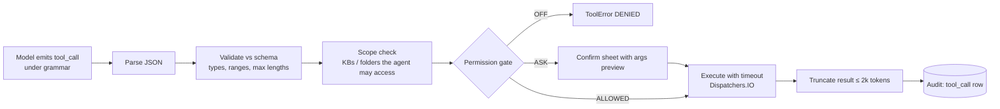

# Security and Privacy

Status: Draft for approval · Phase 3 output

## 1. Privacy promise (user-facing)

1. Your chats, documents, agents and memories stay on this device.
2. LOCAL AI works without an account and without internet once a model is installed.
3. The app connects to the internet only when you download or update a model or a text-recognition language pack, or refresh the model catalog, and, only if you turn it on, to send your daily digest to your own mail server (ADR-0014). You can see every connection in **Settings › Privacy › Network log**.
4. No analytics, no ads, no third-party SDKs that phone home.
5. You can delete any memory, document, conversation or everything at once.

## 2. Threat model

| Asset | Threat | Mitigation |
|---|---|---|
| Documents, chats, memory | Other apps reading data | App-private storage (sandbox) + file-based encryption (Android FBE); no world-readable files; no external storage for private data |
| Same | Device theft (locked) | FBE: credential-encrypted storage is unavailable until first unlock |
| Same | Device theft (unlocked) / shared device | Optional app lock (BiometricPrompt + device credential) in Settings |
| Same | Cloud backup leakage | `android:allowBackup="false"`, data extraction rules exclude everything; user-initiated encrypted export only (V1.x) |
| Same | Accidental network exfiltration | Network code confined to `:data:downloads`; host allowlist; no network-capable tools; lint + dependency guard; network log |
| Device integrity | Malicious model file | GGUF validated before load; catalog checksums; imported models flagged "unverified"; llama.cpp parsing hardened by pinning releases with security fixes; fuzz our GGUF metadata reader |
| Device integrity | Malicious documents (parser exploits, zip bombs) | Parsing in `isolatedProcess` service, size/ratio/time limits, fd-only access |
| User intent | Prompt injection via documents or memory | Sources marked as untrusted data in prompts; side-effecting tools always "Ask"; tools cannot reach network; agents cannot change permissions; injected text cannot enable tools |
| User intent | Agent misuse of tools | Typed tools, schema validation, permission gate, budgets, audit log |
| App | Model-generated code execution | **Not supported.** No interpreter, no `eval`, no shell, no dynamic code loading |

## 3. Tool registry: secure execution

### 3.1 Contract

```kotlin
interface Tool<I : Any, O : Any> {
    val id: String                      // stable snake_case
    val version: Int
    val description: String             // one sentence shown to model and user
    val inputSchema: JsonSchema         // also compiled to GBNF
    val risk: ToolRisk                  // READ, WRITE_LOCAL, DELEGATE
    val timeout: Duration
    suspend fun execute(input: I, ctx: ToolContext): ToolOutcome<O>
}

data class ToolContext(val agentId: AgentId, val runId: RunId, val scope: DataScope, val budget: BudgetView)
sealed interface ToolOutcome<out O> {
    data class Ok<O>(val value: O, val display: String) : ToolOutcome<O>
    data class Error(val code: ToolErrorCode, val message: String) : ToolOutcome<Nothing>
}
```

### 3.2 Invocation pipeline



### 3.3 Built-in tools

| Tool | Risk | Default permission | Input (summary) | Guardrails |
|---|---|---|---|---|
| `calculator` | READ | Allowed | `{expression: string ≤ 200}` | Own recursive-descent parser (numbers, + − × ÷ ^ %, parentheses, sqrt/log/sin…); no variables, no eval |
| `file_search` | READ | Ask | `{query, extensions[], max_results ≤ 20}` | Only SAF trees the user granted; returns names/paths, not contents |
| `document_reader` | READ | Allowed | `{document_id, page_range?}` | Only documents in the agent's KBs; ≤ 2k tokens per call |
| `note_manager` | WRITE_LOCAL | Ask for create/update/delete, Allowed for list/read | `{action, note_id?, title?, body ≤ 4000}` | Agent-created notes labelled; delete needs confirmation always |
| `knowledge_search` | READ | Allowed | `{query, kb_ids?, k ≤ 10}` | Scope limited to agent's KBs |
| `sqlite_query` | READ | Ask | `{sql ≤ 1000, max_rows ≤ 200}` | Separate read-only connection to a **user data DB** (CSV imports/notes views), `SQLITE_OPEN_READONLY`, authorizer allows only `SELECT` on allowlisted tables, `PRAGMA query_only`, 2 s progress-handler timeout; never touches `app.db` internals |
| `code_search` | READ | Allowed | `{query, kb_id, language?}` | Searches code KBs (FTS + vectors); read only |
| `delegate_to_agent` | DELEGATE | Allowed within workflow | `{agent_id, instruction ≤ 1000}` | Depth ≤ 2, agent must be in workflow, counts toward budgets |

There are no network tools, no shell, no package install, no intent-launching tools at MVP. Any future tool with external side effects (send message, open URL) will require `ASK` permanently and a human-readable preview.

## 4. Data at rest

- **Default:** Android FBE + app sandbox. This is the platform's supported model and costs nothing at runtime.
- **Optional "Vault" (V1.x):** SQLCipher-encrypted `app.db`/`knowledge.db` with a key wrapped by Android Keystore (StrongBox when available), unlocked with biometrics. Cost: ~5–15 % DB overhead; requires our custom SQLite build to include SQLCipher for `knowledge.db` (licence: BSD-style, compatible).
- Document copies and KV caches stay in app-private dirs; KV caches cleared on "Forget" actions affecting their prompts.

## 5. Network

- `network_security_config.xml`: cleartext disabled; HTTPS only.
- Hosts allowlist for downloads: catalog-defined hosts (e.g. `huggingface.co`, its CDN) and `raw.githubusercontent.com` for pinned, checksum-verified text-recognition language packs (ADR-0016). Custom URL download (V1.x) shows the host and requires confirmation.
- No `INTERNET` usage outside OkHttp in `:data:downloads` (Gradle module dependency check + custom lint rule forbidding `java.net`/OkHttp imports elsewhere).
- Network log: every request (host, path, bytes, time) stored locally for 30 days.

## 6. Permissions

| Permission | Why | When requested |
|---|---|---|
| `INTERNET` | Model downloads | Install-time (normal permission) |
| `POST_NOTIFICATIONS` | Download progress, long workflow runs | When first download starts |
| `FOREGROUND_SERVICE` + type `dataSync` | Downloads | — |
| `FOREGROUND_SERVICE` + type for long runs | Workflows while backgrounded | Policy decision pending (see approval questions) |
| Storage | **Not requested**: SAF pickers and folder links (persisted, read-only) | When linking a folder |
| `READ_SMS`, `READ_CONTACTS`, call log | **Not requested** (removed 2026-11-17): Google Play Protect blocks sideloaded apps that ask for them (ADR-0013 update) | — |
| `CALL_PHONE` | **Not requested**: the dialer opens with the number; the user presses Call | — |
| `RECORD_AUDIO` | Voice dictation and voice conversation (ADR-0015); on-device recognizer preferred | First tap on a microphone |
| `CAMERA` | **Not requested**: the camera app takes the photo and writes it to a FileProvider URI the app owns | — |

### 6.0 Content shared into the app

"Share → Check with LOCAL AI" (`ACTION_SEND`, text or one image) is the only way the app sees a message from another app. The text or image is used on the phone for Scam check or Read it to me; shared images are copied into app storage and deleted with the screen. No SMS, notification or accessibility access is requested (ADR-0016).

### 6.1 Files shared with other apps

Exports (`files/exports`) and camera captures (`cache/camera`) are the only paths in the FileProvider. Each share or open grants read access to one file, temporarily. Chat photos stay in `files/chat_images` and are deleted with their conversation or by "Erase everything".

## 7. User control

- Memory: per-agent toggle, approval inbox, edit, delete, forget all.
- Data: delete conversation / KB / document; "Erase everything" wipes DBs, docs, caches, models (two-step confirmation in-app).
- Transparency screens: what an agent saw (prompt inspector for any message, developer option), tool audit log, network log.

## 8. Secure development

- Dependencies pinned with checksums (Gradle verification metadata).
- Native: `-fstack-protector-strong`, `_FORTIFY_SOURCE=2`, CFI where supported, HWASan builds in CI on arm64 emulator/device.
- Fuzzing: GGUF metadata reader, DOCX parser, calculator parser, JSON tool-arg validator (libFuzzer/Jazzer).
- Release: R8, no debug logging of content (logger strips message bodies in release).
