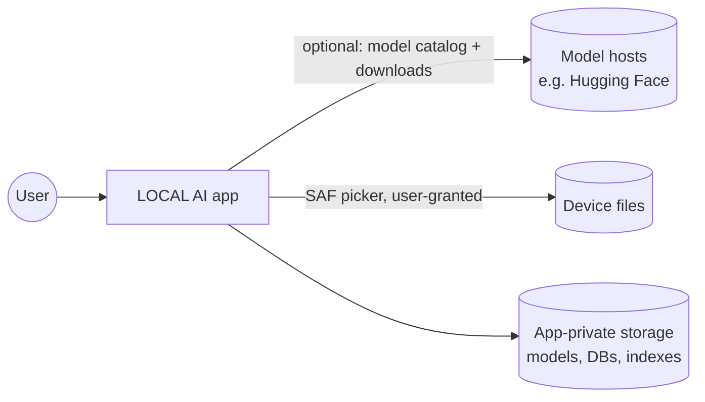
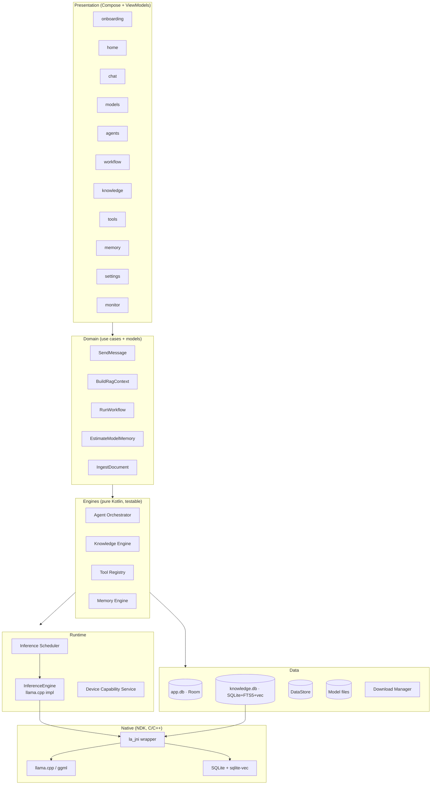
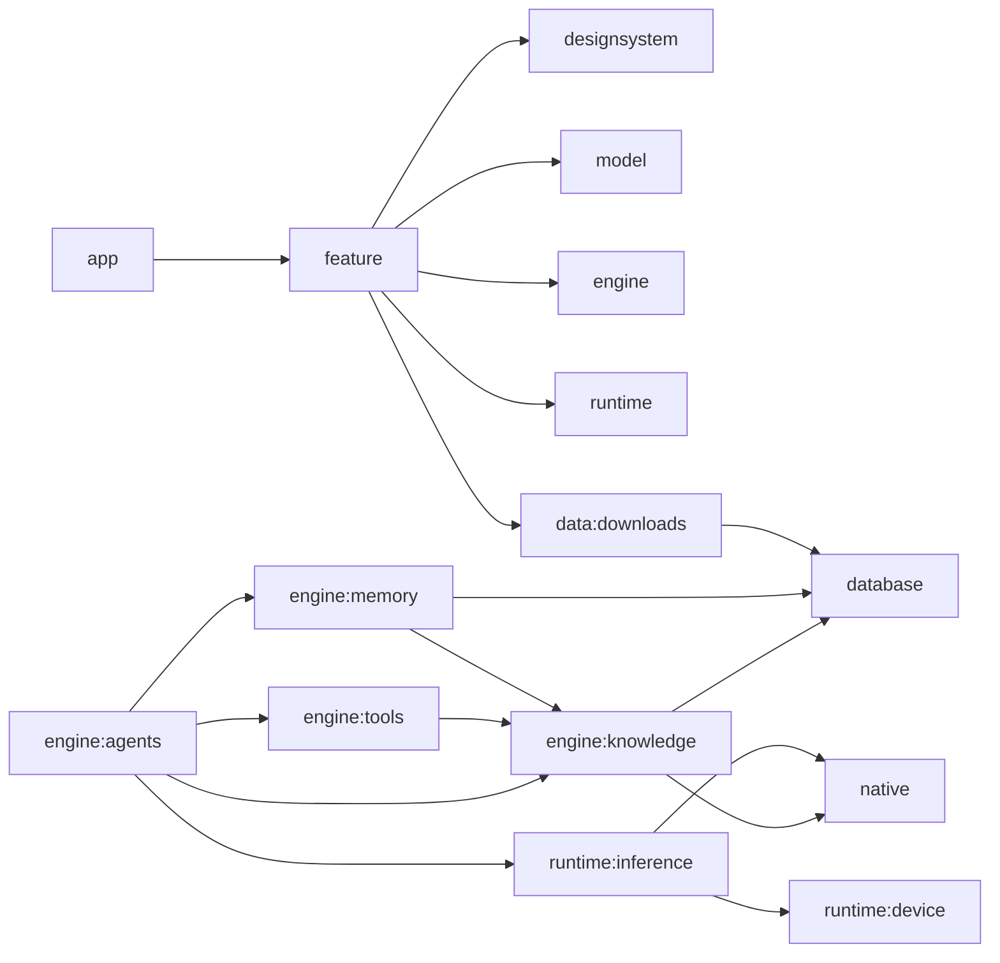
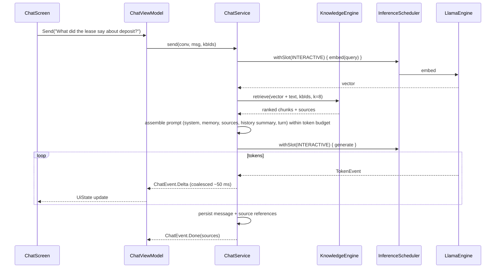
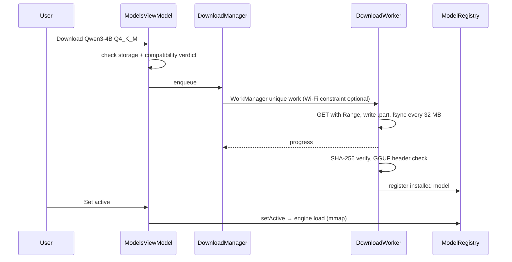
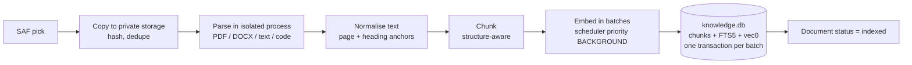

# System Architecture

Status: Draft for approval · Phase 3 output

## 1. Context



Network is used only by the Downloads module, and only after a user action. Everything else runs on the device.

## 2. Layered view



Rules:

- UI depends on domain interfaces, never on engines' internals or native code.
- Engines are pure Kotlin with interfaces for the runtime and stores, so they run in JVM unit tests with fakes.
- Only `:core:native` contains C/C++. Only `:data:downloads` may open network sockets (enforced by a lint rule and a dependency check).

## 3. Module structure (Android)

```
local-ai-android/
├─ app/                       Application, nav graph, Hilt root, manifest
├─ core/
│  ├─ common/                 Result types, dispatchers, logging (local only)
│  ├─ designsystem/           Tokens, theme, components (LaCard, LaChip, StatusPill, …)
│  ├─ model/                  Domain entities (Model, Agent, KnowledgeBase, …)
│  ├─ database/               Room app.db, DAOs, migrations
│  ├─ datastore/              Proto DataStore settings
│  └─ native/                 CMake: llama.cpp, ggml, sqlite+vec, la_jni; Kotlin bindings
├─ runtime/
│  ├─ inference/              InferenceEngine, LlamaEngine, InferenceScheduler, PromptCache
│  └─ device/                 DeviceCapabilityService, ThermalMonitor, MemoryPressureMonitor
├─ engine/
│  ├─ agents/                 Orchestrator, Planner, StepExecutor, Budgets
│  ├─ knowledge/              Parsers, Chunker, Embedder, Retriever, KnowledgeStore
│  ├─ tools/                  ToolRegistry, schemas, built-in tools, PermissionGate
│  └─ memory/                 ConversationMemory, AgentMemoryStore, MemoryExtractor
├─ data/
│  └─ downloads/              OkHttp, WorkManager DownloadWorker, Catalog
└─ feature/
   ├─ onboarding/ home/ chat/ models/ agents/ workflow/
   └─ knowledge/ tools/ memory/ settings/ monitor/
```

Module dependency graph (arrows = "depends on"):



`engine:knowledge` is reused by memory (agent memories are embedded with the same embedder, stored in a separate table).

## 4. Component responsibilities

| Component | Responsibility | Key interface |
|---|---|---|
| `InferenceEngine` | Load/unload a model, tokenize, generate with sampling params, embed, save/restore sequence state, abort | `suspend fun load(spec): LoadedModel`, `fun generate(req): Flow<TokenEvent>`, `suspend fun embed(texts): FloatArrays` |
| `InferenceScheduler` | Single-slot priority queue in front of the engine. Serialises access, preempts low-priority (background ingestion embeddings) for interactive chat, enforces one generation at a time | `suspend fun <T> withSlot(priority, block)` |
| `ModelRegistry` | Installed models, active model, inference profiles | `Flow<List<InstalledModel>>` |
| `DeviceCapabilityService` | RAM, SoC, CPU features, GPU, storage, thermal, battery; produces `DeviceProfile` and compatibility verdicts | `fun profile(): DeviceProfile`, `fun verdict(model, ctx): Compatibility` |
| `DownloadManager` | Resumable downloads, checksum, catalog refresh | `fun enqueue(modelId)`, `Flow<DownloadState>` |
| `ChatService` | Conversation lifecycle, prompt assembly, streaming, persistence, summarisation | `fun send(convId, msg, options): Flow<ChatEvent>` |
| `KnowledgeEngine` | Ingestion pipeline, retrieval, hybrid ranking | `fun ingest(kbId, uri): Flow<IngestProgress>`, `suspend fun retrieve(query, kbIds, k)` |
| `ToolRegistry` | Register tools with schemas, validate args, enforce permissions, execute with timeouts, audit | `suspend fun invoke(call, ctx): ToolResult` |
| `MemoryEngine` | Conversation summaries, agent memory CRUD, proposals, retrieval | `suspend fun recall(agentId, query)`, `fun propose(...)` |
| `Orchestrator` | Plan → schedule → execute → review → aggregate, with budgets and cancellation | `fun run(request): Flow<RunEvent>` |

## 5. Key data flows

### 5.1 Chat with knowledge base (sequence)



### 5.2 Model download and activation



### 5.3 Ingestion



## 6. Threading and concurrency model

| Work | Dispatcher / thread | Notes |
|---|---|---|
| UI | Main | Coalesced state updates |
| Generation, embeddings | Dedicated native threads owned by llama.cpp (`n_threads` = performance cores) launched from a single-thread `inferenceDispatcher` | One active generation at a time |
| Tool execution | `Dispatchers.IO` with per-tool timeout | May overlap with LLM work |
| Ingestion parsing | Isolated `:parser` process via bound service | Crash-contained |
| DB | Room's executors; knowledge.db on a single-writer dispatcher | WAL mode |

Cancellation: every long operation is a coroutine. On cancel, the engine's abort callback is set, which llama.cpp checks between decode batches; the next token loop exits within one batch (~50–200 ms).

## 7. Error handling strategy

| Class | Example | Handling |
|---|---|---|
| User-recoverable | Not enough storage, model too large, network lost during download | Inline message with a next step (free space, choose smaller quant, resume later) |
| Model errors | Context overflow, invalid JSON despite grammar, empty output | Retry with repair prompt once; truncate/summarise history; surface "model could not complete" with details |
| Tool errors | Validation failure, permission denied, timeout | Returned to the agent as a structured `ToolError` it can react to; counted against budget |
| Resource pressure | `onTrimMemory(RUNNING_CRITICAL)`, thermal SEVERE | Reduce threads, shrink batch, pause background ingestion; at CRITICAL unload model after the current step and tell the user |
| Native crash | SIGSEGV in a backend | Crash-loop detector: after 2 crashes with the same model/backend in 10 minutes, disable that backend and show a report screen |
| Data corruption | DB integrity check fails | Knowledge DB is rebuildable from stored documents: offer re-index. app.db has migration tests and nightly local backup snapshot (last 2) |

All errors are typed (`sealed interface LaError`) and mapped to UI messages in one place.

## 8. Extensibility points

- `InferenceEngine` implementations per backend (llama.cpp now; LiteRT-LM/ExecuTorch later). A model record names its backend.
- `Tool` interface with schema + permission metadata; registration is compile-time only at MVP.
- `DocumentParser` per MIME type.
- `VectorIndex` (sqlite-vec now, HNSW later).
- Model-per-agent: agents already store `modelId`; the scheduler swaps models between steps when they differ (V1.x) and reports swap cost.
