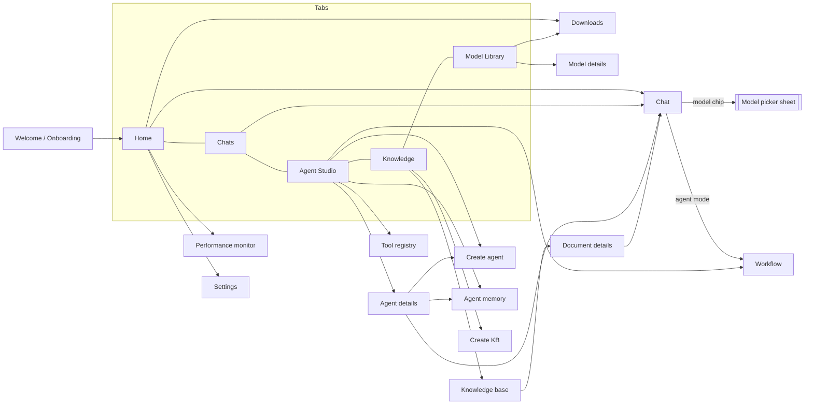

# UI / UX Specification

Status: Draft for approval · Phase 5 output · Implemented as a clickable prototype in `local-ai/prototype/`

## 1. Design direction

LOCAL AI should feel like an instrument, not a chatbot skin: calm graphite surfaces, precise numbers (memory, tokens, context), and colour used for meaning. Dark is the default; a light theme exists for bright environments.

Principles:

1. **State is always visible.** Model loaded or not, indexing progress, step status and budgets are shown in form (pills, bars, dots) as well as text.
2. **Honest numbers.** Every estimate is labelled as an estimate; the device verdict explains why.
3. **One accent, three module hues.** Periwinkle accent for primary actions. Module hues: sky = models, lilac = agents, mint = knowledge. Semantic green/amber/red are reserved for status.
4. **Quiet chrome.** Cards only where an element is a separate object (a model, an agent, a KB). Lists for collections of rows.
5. **Thumb-first.** Primary actions in the bottom area (FAB, sticky action bar, composer). 48 dp minimum targets.

## 2. Design tokens (map 1:1 to Compose `LaTheme`)

| Token | Dark | Light | Compose role |
|---|---|---|---|
| `bg` | `#0B0E13` | `#F3F4F8` | `background` |
| `surface-1/2/3/4` | `#11151C / #171C25 / #1F2530 / #282F3C` | `#FFFFFF / #F6F7FB / #ECEEF4 / #E1E4EC` | `surfaceContainerLow…Highest` |
| `line`, `line-strong` | `#2A3140`, `#3A4253` | `#DDE1EA`, `#C7CCD8` | `outlineVariant`, `outline` |
| `text`, `text-2`, `text-3` | `#E8EBF1`, `#A7AEBB`, `#707A8A` | `#141821`, `#4D5565`, `#7C8494` | `onSurface`, `onSurfaceVariant`, custom |
| `accent` | `#8EA8FF` | `#3E5BD8` | `primary` |
| `hue-model / agent / knowledge` | `#7CC7FF / #C39BFF / #6FD3B0` | `#1A73B8 / #7A45D6 / #13866A` | `LaColors.model/agent/knowledge` |
| `ok / warn / bad / pending` | `#5FD08E / #F2B45A / #F27A6E / #8A93A3` | `#1B8A4B / #A8650A / #C2382C / #6B7383` | `LaColors.status*` |

Type: Space Grotesk (display, headings, numbers), Inter (body), JetBrains Mono (tokens, ids, code). Scale: 28 / 22 / 19 / 17 / 15 / 14.5 / 13 / 12 / 11. Numbers in columns use tabular figures.

Shape: radius 6 / 10 / 14 / 20 / 28. Spacing on a 4 dp grid (4, 8, 12, 16, 20, 24, 32). Screen gutter 16 dp.

Motion: 200–280 ms, `cubic-bezier(.2,.8,.2,1)`. Running states pulse; workflow edges animate a dash while data flows. All motion respects reduced-motion settings.

## 3. Component inventory

| Component | Use | Compose equivalent |
|---|---|---|
| TopBar (title + subtitle + actions) | Every screen; subtitle carries live context ("Qwen3 4B · ready") | `TopAppBar` custom |
| BottomNav (5) | Home, Chat, Agents, Knowledge, Models | `NavigationBar` |
| StatusPill | Completed / Running / Pending / Failed / Skipped / Cancelled / Indexed | custom `LaStatusPill` |
| VerdictCard | Runs well / Tight fit / Not recommended with memory stack bar | custom |
| MemoryStackBar + legend | Weights / KV / compute vs budget; device RAM; storage | custom Canvas |
| ModelCard, AgentCard, KnowledgeCard | Collection items | `ElevatedCard` restyled |
| Chip / FilterChip / Tag | Filters, selections, metadata | `FilterChip`, `AssistChip` |
| SegmentedControl | Permissions, KV precision, theme, device | `SingleChoiceSegmentedButtonRow` |
| Switch, Slider with value badge | Settings and inference parameters | M3 |
| BottomSheet | Pickers, confirmations, details | `ModalBottomSheet` |
| Composer | Chat input with KB chip, agent chip, attachments, context meter, send/stop | custom |
| Markdown renderer + CodeBlock | Assistant messages | custom AnnotatedString renderer |
| SourceChip / SourceRow | Citations | custom |
| WorkflowGraph | DAG with state colouring and animated edges | Compose Canvas |
| ExecutionLog, BudgetMeters | Workflow transparency | custom |
| Sparkline, CoreBars | Performance monitor | Canvas |
| Banner (info / warn / ok / bad) | Inline system messages | custom |
| Toast | Confirmation of completed actions | `Snackbar` |

## 4. Navigation map

## 5. Screen specifications

Each screen lists purpose, key content, primary action and states. All 17 are implemented in the prototype.

| # | Screen | Purpose & content | Primary action | Key states |
|---|---|---|---|---|
| 1 | Welcome / Onboarding | 4 steps: value, privacy promise, device check (RAM, SoC, CPU features, GPU, storage, model budget), starter model recommendation | Download and continue | Scanning, recommendation per device tier, skip |
| 2 | Home | Active model card with load state, quick actions, device memory stack, downloads, recent chats, agents rail, KBs | New chat | Model loaded / loading / unloaded; downloads running |
| 3 | Chat | Messages with markdown/code/citations, model chip, KB chip, agent-mode chip, attachments, context meter, send/stop | Send | Streaming (cursor + stop), stopped, model not loaded, workflow message |
| 4 | Model Library | Search, Chat / Installed / Embedding, "Fits this device", cards with params, quant, arch, size, rec. RAM, verdict | Download | Downloading %, installed, active, not recommended confirmation |
| 5 | Model Details | Specs grid, verdict + memory breakdown, inference settings (context, temperature, top-p, KV), benchmark, chat template | Set active / Download | Estimate updates live with context length |
| 6 | Downloads | Storage stack, Wi-Fi only, progress, speed, ETA, pause/resume/cancel, completed list | Pause / Resume | Running, paused, verifying checksum, completed |
| 7 | Agent Studio | Supervisor workflow entry, filters, agent cards (role, model, KBs, tools, memory, last status) | New agent | Failed agent highlighted; model not installed warning |
| 8 | Create Agent | Step 1 template grid; step 2 identity, prompt, model, tools, KBs, memory, execution limits | Create | Validation (name required/unique, prompt length) |
| 9 | Agent Details | Status, stats, config, tools with permission, KBs, memory preview, prompt, recent runs | Chat | Last run failed banner with fix suggestion |
| 10 | Workflow | Request, controls, state legend, shared model slot line, DAG graph, budgets, log, node detail sheet | Run | Running, paused, cancelled, completed, partial (retry step), transient failure retry |
| 11 | Knowledge Dashboard | Totals, semantic search, KB cards (docs, size, status, updated, scope) | New KB | Indexing %, failures |
| 12 | Create KB | Name, description, scope (shared / one agent), sources (files, note), advanced (embedding model, chunk size, overlap) | Create and index | Validation; scanned PDF warning |
| 13 | Document Details | Status, pipeline (extract → chunk → embed → indexed), metadata, extracted text, chunks | Ask about it | Failed with reason (OCR), re-index |
| 14 | Tool Registry | Tool cards with risk class, permission segment, used-by, JSON schema, calculator try-out; audit log | Change permission | Rejected calls (invalid SQL), timeouts |
| 15 | Agent Memory | Agent selector, memory toggle, inbox (approve/discard), remembered list (pin, edit, delete), forget all, explainer | Remember | Memory off, empty |
| 16 | Settings | Theme, device (simulated), inference defaults, GPU (experimental), indexing/memory policy, privacy + network log, storage, erase | — | Confirmation for destructive actions |
| 17 | Performance Monitor | tok/s sparkline, memory composition, CPU cores, thermal state + headroom, battery, adaptive behaviour rules | Simulate generation toggle | Thermal normal / moderate / severe |

## 6. Content and copy rules

- Name things by what people recognise: "Knowledge base", "Memory", "Model budget", not "vector store", "KV".
- Technical terms appear in secondary text for power users (e.g. "q8_0 halves context memory").
- Buttons state the action ("Create and start indexing"); toasts confirm the result ("Knowledge base created").
- Errors say what happened and what to do: "No text layer found (scanned image). OCR is planned for a later release."
- Every simulated element in the prototype carries a "Sample data" or "Simulated" label.

## 7. Accessibility

- Contrast ≥ 4.5:1 for text on all surfaces in both themes; status colours paired with shape (dot, dashed outline for skipped).
- Every icon button has a content description; sheets are dialogs with focus moved inside; Escape/back closes.
- Dynamic type up to 200 %: cards reflow; no fixed-height text containers.
- Workflow graph has an equivalent text log and each node is focusable with its state in the label.

## 8. Prototype findings (Phase 7 refinement log)

| Finding | Change made |
|---|---|
| Re-rendering on every simulation tick restarted the fade-in animation and lost text typed into inputs | Animations only on navigation; inputs, checkboxes and focus are preserved across refreshes |
| Dragging the context slider re-rendered the screen mid-drag | Slider updates its value badge while dragging and recomputes the estimate on release |
| Memory budget formula based on momentary free RAM marked 4B models "not recommended" on 8 GB phones, contradicting real-world behaviour | Budget based on total RAM (`0.5 × RAM − 0.4 GB`), free RAM used only for a load-time hint; docs updated |
| Users could not tell why a workflow was slow | Added the "shared model slot" line showing which agent holds the model and which tools run in parallel |
| Failed workflow steps left the user stuck | Partial result with skipped dependents, plus "Retry coding step" |
| Simulation refresh closed open bottom sheets and detached buttons mid-tap | Sheets and toasts moved outside the re-rendered view; ticking screens update progress bars in place and fully refresh only on state changes |
| "New agent" floating button overlapped the bottom navigation | FAB anchored to the screen content area, above the nav bar |
| Onboarding could queue a second download of a model that already had a paused one | Starter download resumes the existing download instead |
| Running-state dot drifted out of workflow nodes; long step labels overflowed nodes | Opacity-only pulse inside SVG; labels truncated to the node width |
